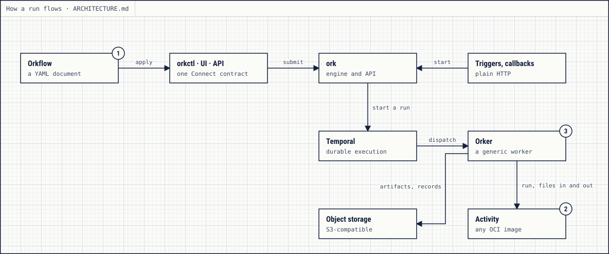
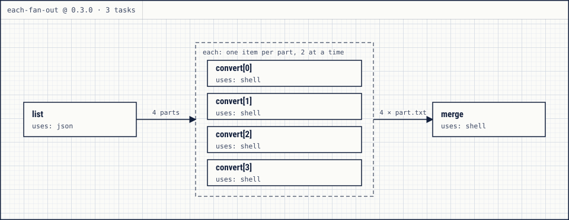
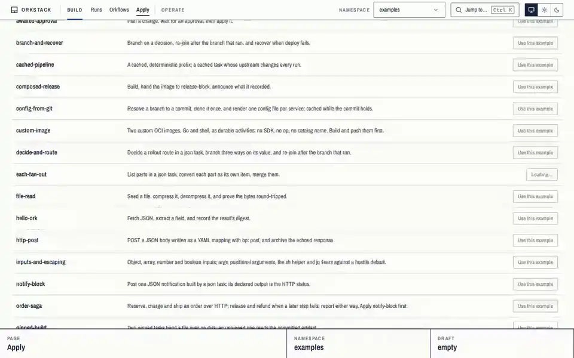
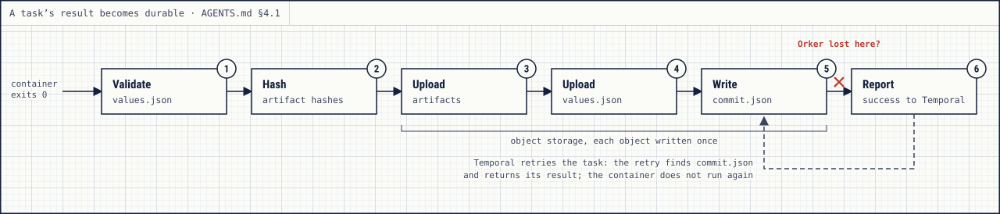

<h1 align="center">OrkStack</h1>

<p align="center">
  Durable workflows without workflow code. Write an <em>Orkflow</em> in YAML,
  and every step runs as an ordinary OCI container on Temporal, with no SDK
  in your images.
</p>

<p align="center">
  <a href="https://orkstack.github.io/orkstack/"><strong>Documentation</strong></a>
  ·
  <a href="./docs/GETTING_STARTED.md">Getting started</a>
  ·
  <a href="./examples/README.md">Examples</a>
  ·
  <a href="./CHANGELOG.md">Changelog</a>
</p>

<p align="center">
<picture>
  <source media="(prefers-color-scheme: dark)" srcset="docs/images/cli-quickstart-dark.gif">
  
</picture>
</p>

> **Status: pre-release.** Stable, but breaking changes may be introduced
> until 1.0. Each one is listed in [CHANGELOG.md](./CHANGELOG.md), marked
> **BREAKING**.

## What it is

OrkStack runs multi-step work durably: a deploy that waits for an approval,
a batch that fans out over a thousand files, a nightly job that has to
finish even when the machine running it goes away. You describe the steps in
a YAML document, an *Orkflow*, and each step is an ordinary container image
that reads files, writes files and exits. There is no workflow code to write, no SDK to link
into your images, and no worker service to run for them.

Underneath, OrkStack is a thin contract between three boring parts:

| Part | Owns |
|---|---|
| **Temporal** | execution: scheduling, retries, timers, signals, durable state |
| **Object storage** (S3-compatible) | data: artifacts, logs, immutable records |
| **OCI containers** | computation: any image, run by a disposable worker (an *Orker*) |

<picture>
  <source media="(prefers-color-scheme: dark)" srcset="docs/images/architecture-dark.svg">
  
</picture>

- **Durable by construction.** Retries, timeouts, timers, approvals and
  cancellation are Temporal's. A run is never lost with an OrkStack process:
  it carries on, or fails with a reason that says why. OrkStack adds no second
  state machine and no database of its own.
- **Any image is an activity.** The contract is the filesystem: inputs under
  `/orkstack/input`, results under `/orkstack/output`, logs on stdout and
  stderr, and an exit code. A shell script in an Alpine image qualifies.
- **Files between tasks.** A task's output files go to object storage and
  arrive as files in the tasks that need them, never through the engine.
- **Immutable and pinned.** Applying an Orkflow stores an immutable version
  with every image resolved to a digest, and a run finishes on the version it
  started with.
- **One contract, three clients.** The `orkctl` CLI, the browser UI and any
  program of yours speak the same Connect API.

[ARCHITECTURE.md](./ARCHITECTURE.md) shows how a run flows through the
pieces.

## An Orkflow

[`examples/each-fan-out.ork.yaml`](./examples/each-fan-out.ork.yaml): compute
a list in one task, convert each element as its own durable item, then merge
the results.

```yaml
apiVersion: orkstack/v1
kind: Orkflow
name: each-fan-out
version: "0.3.0"
description: "List parts in a json task, convert each part as its own item, merge them."

tasks:
  - id: list
    uses: json
    network: none
    with:
      op: query
      nullInput: true
      vars:
        parts:
          - name: a
          - name: b
          - name: c
          - name: d
      filter: '$vars.parts'

  - id: convert
    uses: shell
    needs:
      - list
    each:
      over: '{{ .tasks.list.output.result }}'
      as: part
      max_items: 50
      max_parallel: 2
    retry:
      maximum_attempts: 2
    with:
      op: script
      interpreter: sh
      script: |
        set -eu
        # `sh` quotes the item's value for the shell (AGENTS.md §6).
        printf '%s\n' {{ sh .each.part.name }} > /orkstack/output/artifacts/part.txt
        echo converted {{ sh .each.part.name }} "({{ .each.index }} of {{ .each.count }})"

  - id: merge
    uses: shell
    needs:
      - convert
    with:
      op: script
      interpreter: sh
      script: |
        set -eu
        cat /orkstack/input/artifacts/convert/*/part.txt | tee /orkstack/output/artifacts/merged.txt
```

Tasks form a graph whose only edges are `needs:`. `each:` fans `convert` out
into one item per element of `list`'s result, at most two at a time, each
with its own attempts and logs; `merge` starts once every item has ended and
reads the files they wrote:

<picture>
  <source media="(prefers-color-scheme: dark)" srcset="docs/images/each-fan-out-run-dark.svg">
  
</picture>

The [DSL reference](./docs/DSL.md) covers the rest: typed `inputs:`,
`condition:`, retries and timeouts, `await:` for approvals and external
completion, `cache:`, `join:` and failure handlers, composition with
`uses: orkflow:<name>@<version>`, pools and pins.

## Watch it run

The UI draws each run as its graph and follows it live: every task's
attempts, timing, logs, values and artifacts, and a fan-out's items one by
one.

<p align="center">
<picture>
  <source media="(prefers-color-scheme: dark)" srcset="docs/images/ui-demo-dark.webp">
  
</picture>
</p>

## How a result becomes durable

A task runs at least once: if the Orker running it goes away, the task is
retried. Its result is committed to object storage before success is
reported, so a retry that finds the commit returns it instead of running the
container again. Side effects outside OrkStack can repeat; every task gets a
stable idempotency key for the systems that need one.

<picture>
  <source media="(prefers-color-scheme: dark)" srcset="docs/images/durable-commit-dark.svg">
  
</picture>

## What you get

| | |
|---|---|
| **Authoring** | [fan-out](./docs/DSL.md#fan-out-each), [approvals and external waits](./docs/DSL.md#awaited-tasks), [caching](./docs/DSL.md#caching-cache), [failure handlers](./docs/DSL.md#joins-and-failure-handlers-join), [composition](./docs/DSL.md#composition-uses-orkflow), pools and [pins](./docs/DSL.md#pins) |
| **Starting runs** | `orkctl run submit` and `run plan`, [schedules](./docs/ORKFLOW_SCHEDULES.md) with backfill, HTTP [triggers](./docs/ORKFLOW_TRIGGERS.md), [webhooks](./docs/WEBHOOKS.md) |
| **Operating** | namespaces with admission and budgets, image policy, release rollout, [automation documents](./docs/AUTOMATION.md), OpenTelemetry ([DEPLOY.md](./docs/DEPLOY.md)) |
| **Inspecting** | live attempts, timing, run-to-run diffs, [stats](./docs/STATS.md), and [evidence bundles](./docs/RUN_EVIDENCE.md) you can verify offline |

## Quickstart

You need Docker. Each release ships a quickstart bundle: a compose file that
runs the whole stack from that release's images, and the examples.

```bash
curl -fsSLO https://github.com/orkstack/orkstack/releases/latest/download/orkstack-quickstart.tar.gz
tar -xzf orkstack-quickstart.tar.gz && cd orkstack-quickstart
docker compose up -d --wait
alias orkctl='docker compose run --rm orkctl'
orkctl apply examples/each-fan-out.ork.yaml
orkctl run submit each-fan-out --watch
```

Then open the UI at http://localhost:5173. [Getting started](./docs/GETTING_STARTED.md)
walks through each step, and installing `orkctl` itself instead of the alias.
OrkStack has no published release yet: until the first one, build and run it
from source ([CONTRIBUTING.md](./CONTRIBUTING.md), "The local development
stack").

## What it does not do

- It never claims exactly-once execution: tasks run at least once, with a
  stable idempotency key for systems that need one.
- It has no SDK, no worker service to write, and no callback protocol: the
  filesystem is the activity API.
- It is not a visual designer, a scripting language or a connector catalogue.
- It does not run loops or `continue_on_error`: the graph stays a DAG, and
  repetition is a fan-out, a retry policy, a schedule or a task's own image.

[LIMITATIONS.md](./docs/LIMITATIONS.md) lists every hard limit and deliberate
omission, with its setting and its reason.

## Docs

The documentation is published at
**[orkstack.github.io/orkstack](https://orkstack.github.io/orkstack/)**, built
from these files.

- **Start:** [Getting started](./docs/GETTING_STARTED.md) ·
  [Examples](./examples/README.md) · [Architecture](./ARCHITECTURE.md)
- **Authoring:** [Orkflow DSL](./docs/DSL.md) ·
  [Patterns](./docs/ORKFLOW_PATTERNS.md) · [JSON and enums](./docs/JSON.md) ·
  [Schemas](./docs/schemas/)
- **Activities:** [OCI activity contract](./docs/OCI_ACTIVITY_CONTRACT.md) ·
  [Activity images](./docs/ACTIVITY_IMAGES.md)
- **Starting runs:** [Triggers](./docs/ORKFLOW_TRIGGERS.md) ·
  [Schedules](./docs/ORKFLOW_SCHEDULES.md) ·
  [Automation documents](./docs/AUTOMATION.md) · [Webhooks](./docs/WEBHOOKS.md)
- **Operating:** [Deployment](./docs/DEPLOY.md) ·
  [Production checklist](./docs/PRODUCTION_CHECKLIST.md) ·
  [Security model](./docs/SECURITY_MODEL.md) ·
  [Upgrading](./docs/UPGRADING.md) · [Limitations](./docs/LIMITATIONS.md) ·
  [Troubleshooting](./docs/TROUBLESHOOTING.md) ·
  [Storage](./docs/STORAGE.md) · [Stats](./docs/STATS.md) ·
  [Run evidence](./docs/RUN_EVIDENCE.md) ·
  [UI and CLI parity](./docs/UI_CLI_PARITY.md) ·
  [Observability](./deploy/observability/README.md)
- **Reference:** [orkctl](./docs/CLI.md) · [API](./docs/API.md) ·
  [Error reasons](./docs/REASONS.md) · [Changelog](./CHANGELOG.md)
- **Contributing:** [Contributing](./CONTRIBUTING.md) ·
  [Engineering contract](./AGENTS.md) · [Proofs and CI](./docs/PROOFS.md) ·
  [How OrkStack is proven](./docs/PROVEN.md) ·
  [Replay fixtures](./internal/engine/testdata/history/README.md)

## Contributing

Developing OrkStack needs Go and Bun as well as Docker; [CONTRIBUTING.md](./CONTRIBUTING.md)
lists the prerequisites and the local development stack, and
[AGENTS.md](./AGENTS.md) is the engineering contract. Every change ships with
behavior tests, and lands only after a full proof of the merged tree passes:
CI's sharded `proof` check, or `make proof` locally. No proof, no done.

## License

MIT — see [LICENSE](./LICENSE).
