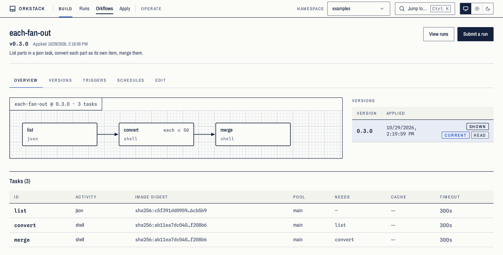
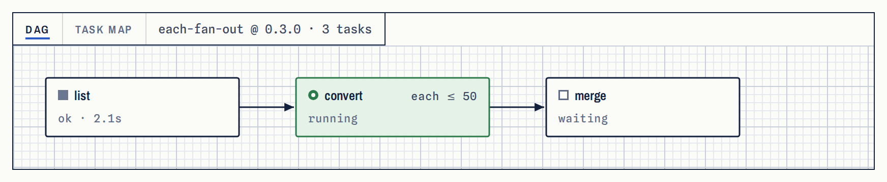
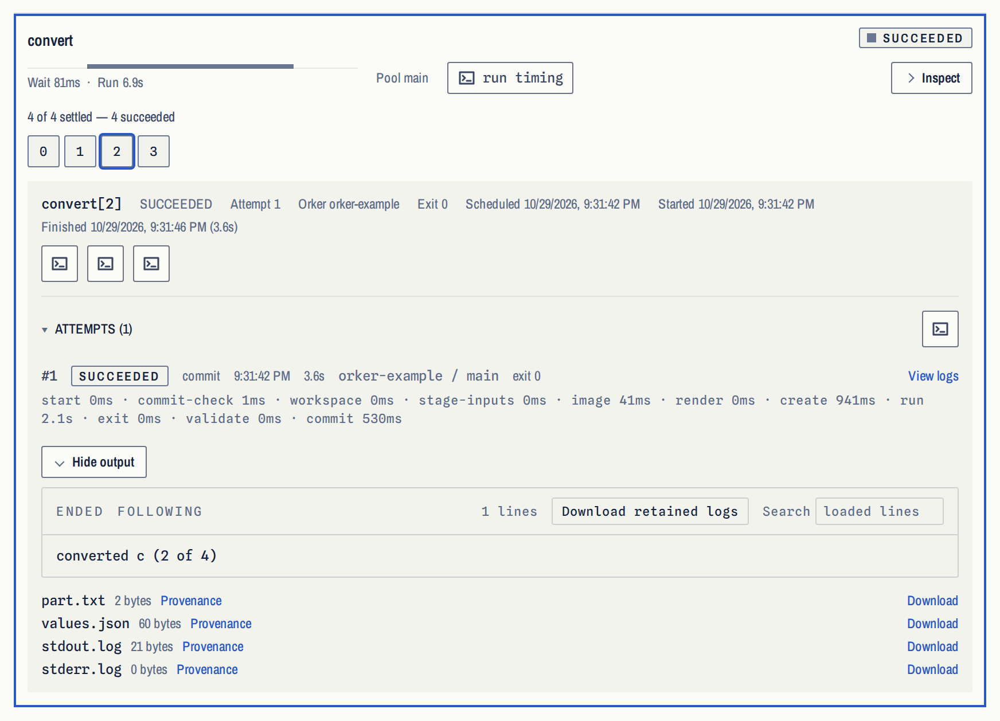
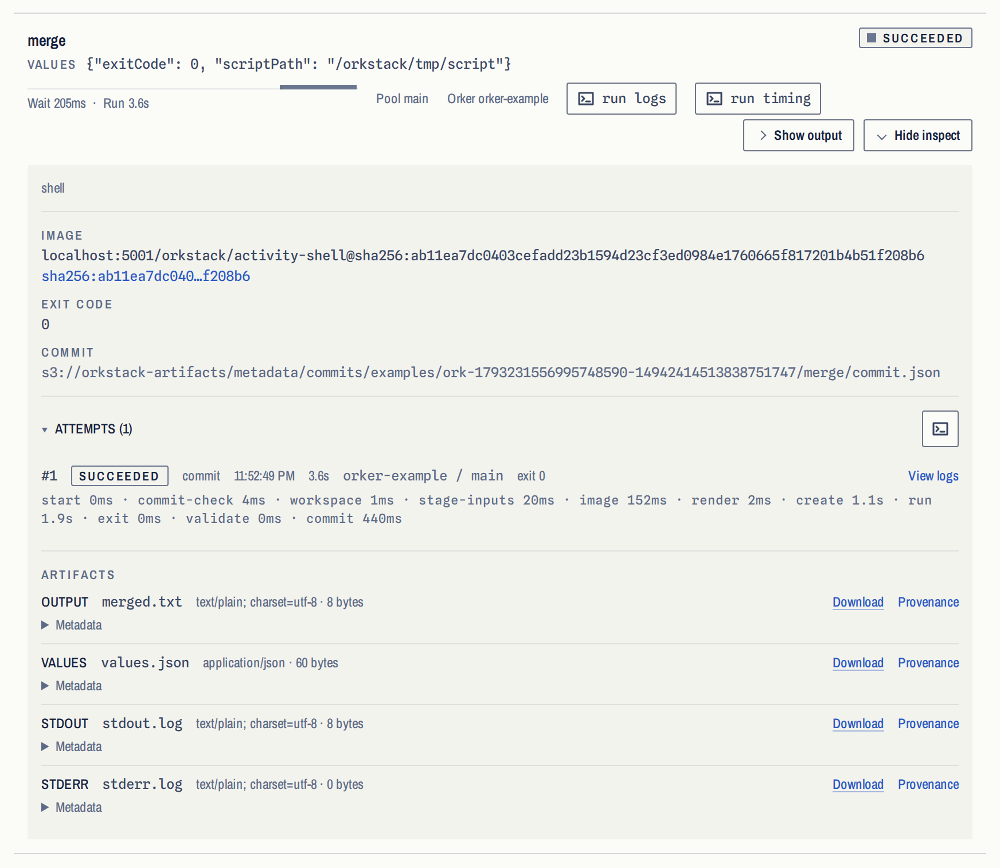

# Getting started

This page takes a machine with Docker to a finished run: the whole stack built
from a clone of this repository, and one Orkflow applied, planned, run and
inspected from the CLI and the UI. Docker and git are the only prerequisites.
Everything here is a local setup; [DEPLOY.md](./DEPLOY.md) is the reference
for a real deployment, and [CONTRIBUTING.md](../CONTRIBUTING.md) runs
OrkStack's processes on the host for working on them.

OrkStack has not reached 1.0: until it does, any release may include breaking
changes, and each is listed in [CHANGELOG.md](../CHANGELOG.md).

<p align="center">
<picture>
  <source media="(prefers-color-scheme: dark)" srcset="images/ui-demo-dark.webp">
  
</picture>
</p>

## What you need

- **Docker** with Compose v2: Docker Engine, or Docker Desktop. The stack
  builds and runs in containers, and so does every task.
- **git**, to clone the repository.

Nothing else: no toolchain and no database of its own. OrkStack runs on a
Temporal cluster and S3-compatible object storage, and the quickstart starts
one of each. This page is checked on Linux with Docker Engine, on amd64; Docker
Desktop on macOS and Windows, and arm64, are not checked yet.

## 1. Clone the repository

```bash
git clone https://github.com/orkstack/orkstack.git
cd orkstack
```

Run every command below from this directory. A clone of `main` is the newest
code; to try a release, clone its tag instead (`git clone --branch vX.Y.Z
https://github.com/orkstack/orkstack.git`).

## 2. Start OrkStack

```bash
docker compose up --build -d --wait
```

[`compose.yaml`](../compose.yaml), at the root of the clone, builds the
engine, the Orker, the UI, `orkctl` and the six first-party activity images
from the clone, then starts Temporal, SeaweedFS as the S3-compatible object
store, an image registry for the activities, the engine, one Orker and the UI.
It returns once each one passes its health check. The first build downloads
the toolchains' images and the dependencies and takes a few minutes; later
builds reuse Docker's build cache. Everything listens on this machine's
loopback only:

| What | Where |
|---|---|
| UI | http://localhost:5173 |
| Engine API | http://localhost:8080 |
| Temporal UI | http://localhost:8233 |

If a port is taken, set `ORKSTACK_UI_PORT`, `ORKSTACK_API_PORT`,
`ORKSTACK_TEMPORAL_UI_PORT` or `ORKSTACK_REGISTRY_PORT` (the registry, 5002)
in a `.env` file beside `compose.yaml`. `docker compose ps` shows what is
running, and `docker compose logs -f ork orker` follows the engine's and the
Orker's logs.

The Orker runs each task as a container on this machine's Docker, through the
Docker socket the compose file mounts into it. Whoever controls that socket
controls the machine, so read [SECURITY_MODEL.md](./SECURITY_MODEL.md) before
running this anywhere but your own machine.

Listening on loopback keeps other machines out, but it is not a login. Any
program on this machine can reach the API and start a run, and so can a web
page you open, by DNS rebinding. Stop the stack with `docker compose down`
when you are done with it. The object store's keys in the compose file
(`orkstack` / `orkstack-secret`) are placeholders, and only the stack's own
services can reach the store.

## 3. Get orkctl

Run it from the image the stack built, with nothing to install:

```bash
alias orkctl='docker compose run --rm orkctl'
```

The alias works from the clone's directory, and the container sees that
directory read-only, which is enough for `orkctl apply examples/…`. A build
from source calls itself `dev` (`orkctl version`). To install the binary itself, build it
with Go (`make build` writes `bin/orkctl`, [CONTRIBUTING.md](../CONTRIBUTING.md))
or take it from a release's archives ([UPGRADING.md](./UPGRADING.md), "Release
artifacts").

## 4. Apply an Orkflow

An Orkflow is a YAML document. [`examples/each-fan-out.ork.yaml`](../examples/each-fan-out.ork.yaml)
computes a list in one task, converts each element as its own durable item,
and merges the results:

```bash
orkctl apply examples/each-fan-out.ork.yaml
```

Applying compiles the document, checks it (names, the dependency graph, every
task's configuration), resolves each image to a digest, and stores an
immutable version. Nothing runs yet.

<p align="center">
<picture>
  <source media="(prefers-color-scheme: dark)" srcset="../site/public/media/ui-orkflow-dark-2x.webp">
  
</picture>
</p>

## 5. Plan it, then run it

```bash
orkctl run plan each-fan-out
orkctl run submit each-fan-out --watch
```

`run plan` says which tasks would run and in what order, and starts nothing.
`run submit --watch` starts a run and follows its events until it ends. Each
task is an ordinary container: it reads its inputs under `/orkstack/input`,
writes its results under `/orkstack/output`, and exits.

Open the run in the UI to watch the same run as a drawing of its tasks:

<p align="center">
<picture>
  <source media="(prefers-color-scheme: dark)" srcset="../site/public/media/ui-run-live-dark-2x.webp">
  
</picture>
</p>

The fan-out task runs one item per element of the list, two at a time
(`max_parallel: 2`), each with its own attempts and logs:

<p align="center">
<picture>
  <source media="(prefers-color-scheme: dark)" srcset="../site/public/media/ui-fanout-dark-2x.webp">
  
</picture>
</p>

## 6. Inspect what it did

```bash
orkctl run logs <run-id> --task merge
orkctl run artifacts <run-id>
```

`run logs` prints a task's stdout and stderr, and `run artifacts` lists the
files the run's tasks wrote, which live in object storage rather than in the
engine. The run page shows the same: every task's attempts, timing, values,
logs and artifacts.

<p align="center">
<picture>
  <source media="(prefers-color-scheme: dark)" srcset="../site/public/media/ui-run-finished-dark-2x.webp">
  
</picture>
</p>

## 7. Update, stop, or start over

```bash
git pull && docker compose up --build -d --wait   # update to the newest code
docker compose down                               # stop; the object store keeps its data
docker compose down -v                            # stop and delete the stored data too
```

`--build` rebuilds whatever the pull changed and reuses the rest. The
quickstart's Temporal keeps its history in memory, so a stopped stack forgets
its runs' histories; the Orkflows and the artifacts are in the object store,
which `down` keeps unless you add `-v`.

## Where next

- [Examples](../examples/README.md) — every example Orkflow and what it
  needs to run.
- [DSL.md](./DSL.md) — every key of an Orkflow.
- [ORKFLOW_PATTERNS.md](./ORKFLOW_PATTERNS.md) — the rules the examples
  follow, and why.
- [OCI_ACTIVITY_CONTRACT.md](./OCI_ACTIVITY_CONTRACT.md) — what a container
  must do to be an activity, for writing your own image.
- [CONTRIBUTING.md](../CONTRIBUTING.md) — work on OrkStack itself, with its
  processes on the host.
