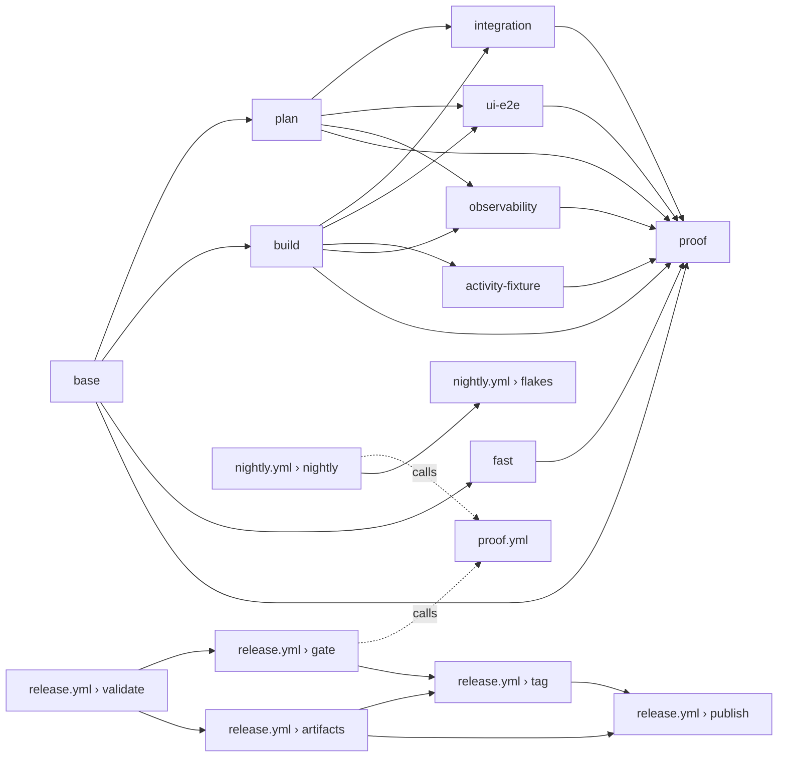

# Proofs and CI

`AGENTS.md` §11 states the rules: no proof, no done, and what a proof must
establish. This file is the reference for how the machinery works: the tiers,
the plan and its shards, the CI job graph, the artifacts, the procedures and
the known gaps. It is not a second statement of the rules — when the two
disagree, `AGENTS.md` wins.

## 1. What a proof is

A proof is observed evidence, never a reading of the code. A suite lists what
it will run from the compiled binary's own listing, runs it, and records one
outcome per listed test with the job that ran it. A skip is never a pass. The
ledgers are checked against those listings, so a test that quietly disappeared
fails the proof. A proof is of a **tree**: the hash of the working tree,
staged and untracked files included, must be the same when it starts and when
it ends, and a merge lands exactly the tree the gate tested.

Every proof names its tier in its directory name, the first line of its
README, its result line and `proof.json`. Evidence is never committed:
`proof/` is gitignored, and the commit or pull request quotes the proof
directory, the tree and the gates that ran. Read `proof.json`, never the
README, for a verdict.

Exit status: `0` pass, `1` a gate failed, `2` an invalid invocation, `77` a
missing prerequisite.

## 2. The tiers

| Tier | Command | Merge evidence | Runs |
|---|---|---|---|
| **feature** | `make proof-feature TESTS=… SPECS=…` | no | the fast gates, the change's evidence, its regression set |
| **full** | `make proof` | yes, on a local host; in CI, the `proof` job | every gate, every test and every spec, except the nightly lists' entries the base also carries |
| **nightly** | `make proof-nightly` | no | only the tests `scripts/proof-nightly-tests.txt` names and the spec files `scripts/proof-nightly-specs.txt` names |
| **release** | `make proof-release` | no; it is a tag precondition | every gate, the nightly tests and specs included, observability always |

A full proof records each nightly-listed test as `deferred`, never as passed,
and only when its base's list also carries it; an entry the change adds runs.
The spec list works the same way for Playwright: a row names a spec file under
`ui/e2e/`, the merge-gate spec files that cover it at a smaller size, the
approval and the reason. The full tier's UI plan leaves out of its files and
shards each spec file both the tree's list and the base's carry, keeps its
tests planned, and the Playwright ledger records each as `deferred` with the
row; a test of such a file that ran, a deferred entry for a file the plan
runs, and a deferral the two lists do not both carry each fail the proof. The
nightly tier's plan holds the listed spec files alone; its merge reads the
tree's list itself (`proofrun merge -nightly-specs`), and while the list has
a row the nightly proof needs a UI plan read from that very list, planning
exactly its rows, and its `ui-e2e` gate — in CI one `ui-e2e` part per listed
spec file, up to the requested UI shards. A feature proof's listing holds
only its selected specs, so it plans with no spec list. Today the list holds
`run-page-ceiling.spec.ts`, the run page at the 4,000-task default ceiling;
the merge gate runs `run-page-reduced-ceiling.spec.ts`, the same measurement
with `engine.orkflow_max_tasks` lowered to 1,000.
The pre-release gate is the full tier with nothing deferred. A tag requires a
passing release proof of the exact commit: `make release-tag` and the workflow
both refuse without one.

The feature tier is never merge evidence. A local full, release or nightly
proof runs its gates on one host and writes one part, `local`, then merges it
with `proofrun merge`. The CI `proof` job runs the same merger over many
parts. There is one verdict implementation.

Every local proof of any tier, and every `scripts/integration.sh` run, first
removes what proofs and test processes that are gone left on the host — their
buckets, Orker work roots and containers — with `proofrun clean -remove`, once
its prerequisites are checked and before its own directory exists; its
`setup.log` opens with the count (§10). It never touches what a live process
owns or a running proof recorded, and the dev stack stays up. A by-hand
`go test -tags=integration` does not clean: run `make proof-clean REMOVE=1`
before it (AGENTS.md §11.1). A CI part runs on a fresh runner and does not.

### 2.1 The gates

A local proof runs its gates in this order: the **fast gates**, alone and one
after another — lint, build, unit, `go vet -tags=integration`, then the UI
type-check and unit suites (after one `svelte-kit sync`, which both read), then
the site gate; then the **setup**, as one
concurrent group — the proof's own Temporal, the activity images, the binaries
and the integration test binaries (`proofrun compile`), each its own row of
`gates.tsv` (`temporal`, `images`, `binaries`, `integration-compile`) and the
group's wall a `setup` row; nothing in it is load-sensitive, no test runs until
it has ended, and a failure of any member stops the others. Within it, `make -C
images push` builds and pushes the six images `IMAGE_JOBS` (default 6) at a
time (`make -C images oci`, a CI build part's, does the same), and one `go
build -o bin/` links the nine stack binaries; then the integration suite with the activity contract
fixture beside it — the only two gates that overlap, and the fixture starts
only once the integration runner has finished its heavy jobs
(`integration-heavy-done`), so a heavy test's quiet host never carries the
fixture's containers; then Playwright, spec files `PROOF_UI_WORKERS` at a
time; then the observability gate. A full proof runs: lint; build; unit; `go vet -tags=integration`; the activity
images, built once from this tree; every integration test whose package's
integration build differs from its unit build, against real Temporal and the
S3-compatible store; the activity contract fixture; the UI type-check, unit
and every Playwright spec; the site's check and build; and the observability
gate when the tree changes a telemetry path. A release proof runs the
observability gate unconditionally.

The proof's own Temporal is the `temporal` service of
`deploy/docker-compose.yml`: its image and its command, read by `proofrun
temporal-args` and started on a port of its own, never a second copy of them
in a script. The command carries two `--dynamic-config-value` settings that
make a worker-deployment version report `Drained` in seconds rather than in
the cluster's default minutes, so the integration tests that wait for a
release to drain (`orkctl release wait`, the continuation chain's rollout) wait
seconds (docs/DEPLOY.md §4, "Underneath"). They are development and proof
settings, not a deployment's.

The **site gate** runs `bun run check && bun run build` in `site/`, logged to
`site.log`: the docs sync, the design-token drift check and `astro check`, then
`astro build` with link validation and a post-build link check. The site
renders the repository's markdown (`docs/`, every `*.md`), the example
Orkflows, `deploy/orkstack.defaults.yaml` and `docs/API.md` (generated from
`proto/`), and takes its whole style from `ui/src/tokens.css`, so a change to
any of them can break it. It needs `bun` and `node` on PATH and
`site/node_modules` (`cd site && bun install --frozen-lockfile`), as the UI
gates need `ui/node_modules`; without them the proof exits `77` before it
writes anything. The full and release tiers always run it, and `proofrun
merge` requires it, so a full proof without a passing `site` gate is not
merge-eligible. The nightly tier does not run it. The feature tier runs it
when a changed path's scope row names `site` (§3). In CI it is part of the
`fast` job, recorded beside the UI gates; that job and `ci.yml` › `feature`
install the pinned Node and `site/node_modules` for it.

Integration tests run as separate processes, `PROOF_JOBS` at a time (default
6; the ordinary jobs keep every slot busy, so the phase's wall is their total
work divided by the slots). Six was first measured with one engine boot in
277 jobs stalled 50 s on its fresh bucket's first read while SeaweedFS grew
and removed per-bucket volumes, and a merge gate is never rerun, so the
default stayed 4 until that stall was tolerated (below) and passing jobs'
buckets were removed while the phase runs. At 6 the proof host, a 2019
MacBook Pro, then ran two full proofs clean: train-a-full in 79.0 min
(integration 2805 s) and train-b2-full in 71.2 min (integration 2760 s).

That stall class is tolerated, and still recorded. Every wait for a process a
test started (`internal/testsupport/bootwait`) allows the boot 180 s, ends at
once when the process has exited instead of polling it, and logs how long the
boot took, with a `WARN` line past 20 s that `proofrun overhead` lists under
"Slow boots". A test binary's bucket create (`s3bucket.Main`) is allowed 120 s
and warns the same way, and the engine's two boot reads log `list_took`, so a
slow boot says which read stalled.

A test process's bucket is removed by the runner, off the process's slot,
because removing a bucket is the store's heaviest per-bucket operation and its
churn was the stall. `proofrun integration` (a local proof, and each CI shard)
gives every test process a file to name its bucket in
(`ORK_TEST_BUCKET_LEFT_FILE`, `integration/<job>.bucket`). A process whose
tests passed writes its bucket's name there and exits (`s3bucket.Finish`); one
with a failure keeps its bucket and writes nothing, as before. The runner's two
sweepers remove those buckets while the phase runs, two minutes each at most,
asking the store to delete the bucket whole and emptying it object by object
only when the store refuses a non-empty one. They do not wait for the phase to
end, because a bucket holds at least one of the store's volumes until it is
removed and a store has a bounded number of them: a SeaweedFS mini server
sizes it from its free disk (290 on the 2019 MacBook Pro host), so a phase that
kept its 343 passing buckets to its end ran out, and every write failed with
`No writable volumes`. A slot hands its process's bucket over before it starts
the next process and waits while four already wait, so the buckets alive at
once never exceed the slots, that backlog and the two removals in flight. When
the phase's last process has ended, still inside the gate's wall, the runner
removes what the sweepers had not reached. It removes only a name of the shape
`s3bucket.Name` makes, never the development bucket. The `bucket sweep:` lines
of `integration.log` say what it kept, what it left (`left s3://… : <error>`),
how many went while the phase ran, and end with
`removed N of M passing job buckets`; a removal that fails costs disk and never
the verdict, and a run a signal stopped removes no more and leaves the rest
named in its hand-off files (§10).

Playwright spec files run on
`PROOF_UI_WORKERS` workers (default 2 — measured clean on a 16-core host,
while at 3 one load-sensitive spec failed in each of three runs): the browser
runs in a network
namespace of its own (`ui/e2e/browser-server.ts`, from the image
`ui/e2e/browser-image.txt` pins; a proof pulls it when the host lacks it), and
every spec file owns its bucket. The spec files that assert a render budget
(`each-fan-out-ceiling.spec.ts`, `run-page-reduced-ceiling.spec.ts` and, where
it is not deferred, `run-page-ceiling.spec.ts`) hold nothing but their budget
test and run alone after the others, as `--project` runs on one worker; the
fan-out's functional tests are `each-fan-out.spec.ts`, which runs with the
others. The run page at the task ceiling runs on the host's Chromium
(`ui/playwright.config.ts`); its two spec files share their steps in
`ui/e2e/runPageCeiling.ts`. `network-change.spec.ts` launches a host-namespace
Chromium of its own as its positive control; every other spec drives the
container. A CI `ui-e2e` part installs the host's Chromium only when its
shard holds one of those three files, decided from the UI plan by the same
rule `scripts/proof-part.sh` applies as a prerequisite of the part:
`playwright install chromium`, the browser from Playwright's own store and
nothing from an apt mirror, because the runner image already carries its
system libraries and `--with-deps`'s apt install from that mirror stalled
the shard past its limit three times (runs 40346476240, 40411125174 and
nightly 40413305751). A launch probe then decides: only a Chromium that
does not launch falls back to `--with-deps`, each install in the two
bounded attempts `proof-fetch` makes (180 s, then 360 s) under a 10-minute
step, and a browser that still does not launch fails the step before the
part.
The gate starts one browser server for both invocations, and the second reuses
the first's UI build when the hash of the build's inputs
(`ui/e2e/build-hash.ts`, written beside `ui/build`) is unchanged. A proof that
runs both integration and Playwright makes that build earlier, while its
ordinary integration jobs run: once `integration-heavy-done` exists (the
fixture's policy, so never beside a heavy test), or once the integration gate
has passed without one, it runs `bun e2e/build-ui.ts` — the same
`ensureUIBuild` the global setup calls — and `playwright test --list` into
`ui-e2e-list.json`, logging both to `ui-prebuild.log`. The Playwright gate
waits for it to end, then uses that listing and finds the build's hash
matching (its log reads `e2e: ui/build is this tree's own (inputs …): not
rebuilt`). It is a head start, never a gate: a failed or interrupted build
leaves no matching hash and a failed listing leaves no file, so the gate
builds and lists for itself as before. A **heavy** test — one whose assertions are
bounds — runs alone, in its own CI shard or first on a local host. A test is
heavy by what it asserts, not by how long it takes: the reduced-ceiling copies
of a moved soak run the same E4/E7 thresholds and are heavy, while a test that
merely waits on a deadline for progress is not. A new test that asserts such a
bound is added to `heavyTests` in `test/tools/proofrun/plan.go`.

### 2.2 Fail fast

A proof is never rerun, so a local proof that has failed a gate can never
become eligible, and everything after that failure only costs time. By default
(`PROOF_FAIL_FAST=1`) `scripts/proof.sh` therefore stops at the first failing
gate, in every tier it runs on one host (feature, full, nightly and release):

- a failure in a fast gate starts no other gate, and nothing long has begun;
- a failure of a setup member (Temporal, images, binaries, the integration
  test binaries) stops the members still running, as integration and the
  fixture stop each other below, and starts no other gate. A member that is
  a shell function ends at once on `SIGTERM`, so the script also signals the
  processes it found under that member's pid before stopping it;
- while the integration suite and the activity fixture run, a failure of
  either stops the other: the script sends `SIGTERM` to the command pid it
  recorded for that gate (never a name or a pattern), waits up to a minute, and
  only then kills what is left of that pid's process tree;
- `proofrun integration -fail-fast` (passed by the script) stops at the first
  failed test no quarantine entry excuses: it ends the running test processes,
  starts no more, and still writes the whole ledger. A test it ended is
  recorded `none` with "not finished", a test it never started with "not
  run", each naming the failure; neither is a pass, and the ledger fails the
  proof. `proofrun integration` ends the same way on `SIGTERM` or `SIGINT`,
  which is how the script stops it;
- Playwright and the observability gate start only while nothing has failed.

The verdict is still written, and it is a failure: `proof.json` has `result:
fail` and `merge_eligible: false`, the README names the failed gate and has a
"Stopped early" section, and the script exits `1`. A gate that was running
when the proof stopped is recorded `stopped` (`stopped: <gate> failed`); a gate
that never began is recorded `not-started` (`not started: <gate> failed`).
Neither is a pass, and `proofrun merge` lists each in `ineligible_reasons`.
When the proof stopped before `proofrun integration` wrote its plan, there is
no plan to merge against: the script runs `proofrun merge -stopped`, which
writes the failing `proof.json` and README from the `local` part alone.

`PROOF_FAIL_FAST=0` runs every gate to its end, in the same order. It changes
no eligibility rule: a proof whose gates all pass is identical either way.
Unit tests are not part of this: the unit suite runs to its end whatever fails
in it. CI parts (`scripts/proof-part.sh`) are unchanged, each part being one
job.

## 3. How `proofrun select` picks evidence

`proofrun select -base REF -out FILE` reads the diff from the merge base and
`scripts/proof-scope.tsv`, and writes the selection the feature proof runs. A
path no row matches, or a row whose action is `full`, refuses the feature tier
(exit `2`): `scripts/`, `.github/`, the Makefiles, `internal/testsupport/` and
`test/tools/proofrun/` change how every suite runs and need the full proof.

The scope table's actions: `go`, `proto`, `ui`, `spec`, `ui-unit`,
`all-specs`, `images`, `examples`, `tool`, `observability`, `site`, `none` and
`full`. A row may name several: `docs/**` is `none,site`, `ui/src/tokens.css`
is `ui,site`. The `temporal` flag marks a package whose evidence must include an
integration test. A `docs` flag marks a row whose change should come with a
documentation change; the proof prints a WARNING for a missing one and never
fails on it.

The selection is:

- **the change's evidence**: every test whose source the diff changes,
  including tests that reach a changed or deleted helper, type, variable or
  `TestMain` through their package's declarations; every test named with
  `-tests` (the pattern must match whole test names); every spec the diff
  changes or `-specs` names; every spec when the Playwright harness or the UI's
  dependencies changed; the activity fixture when `images/` or `test/fixtures/`
  changed; the tests that read a changed example, and the examples spec; the
  tests and specs that run a changed `test/tools/` tool; the observability
  gate when a telemetry path changed; and the site gate when a changed path's
  row names `site` — `site/`, `docs/` and every `*.md`, `examples/`,
  `deploy/orkstack.defaults.yaml`, `proto/`, `ui/src/tokens.css`,
  `ui/src/lib/icons.ts` and `ui/package.json`, which the site renders, imports
  or takes its fonts and style from. A deleted path counts. The gate is that
  path's whole evidence on that account: it asks for no Go test or spec, and a
  path whose row also names `go` or `ui` keeps those requirements. The README
  names the paths each gate ran for, under "Evidence for each changed package
  and path". `proofrun gates -select` prints `site=yes` or `site=no` for the
  script;
- **the regression set**: in every integration package whose test binary
  depends on a changed package — through its imports or a binary its suite
  builds — every test declared in an integration-tagged file, except the slow
  list's (`scripts/proof-slow-tests.txt`). Those are recorded in the
  selection's `slow_omitted` and the README says "left out: on the slow list";
  they are never called deferred, a word that belongs to the nightly tier.

A test reaches a changed helper through the package's top-level declarations
in the build configuration the test compiles in, by syntax alone (no type
checking), and over-selects where it cannot tell. A function, variable,
constant or type is matched by its identifier: any mention of the name, a
selector's included, reaches it. A method is matched by its receiver type and
its name, never by its name alone: a function, a local variable, a field or
another type's method called `m` is not a reference to `T.m`. A changed `T.m`
is reached by a test whose reach mentions `T` and selects `m` (`x.m`, `T.m`,
`(*T).m`); when `m` is exported, by a test whose reach mentions `T` at all,
because another package's code can call an exported method through an
interface the type satisfies and no declaration of the package names that
call; and, when `T` is an alias or is not declared in the package's files of
that configuration, by the selector alone. A method a `_test.go` file adds to
a type a non-test file declares (an `export_test.go` hook) is reached by its
selector alone, whether or not the test names the type: it exists in the test
build only, so production code does not call it through an interface, and the
test's value of the type may come from another package. A deleted method is
matched the same way. Every `init` function of a test file is part of every
test's reach, since it runs before each and can register a type nothing else
mentions; one of a non-test file is not, because it cannot mention a
declaration of a test file.

The slow list also holds back evidence that is there only because it reaches
a changed helper, type or variable: such a test's own source did not change,
so the merge proof runs it. Its `slow_omitted` entry carries `reached`, the
reach that selected it, and the README line ends "evidence only because it
reaches changed <name>; the merge proof runs it". When every test such a
change reaches in a package is slow, the cheapest stays as evidence, marked
"kept: the cheapest of the slow tests the change reaches", so the change
still has a test that exercises it. A test whose own source changed, and
every `-tests` name, always runs; a changed `TestMain` still runs the whole
package, slow tests included. On a shared helper such as `newChaosStack`
this is about 35 minutes of a feature proof.

The regression set is never evidence. Every changed package with a change
outside its tests and its comments needs at least one evidence test whose
binary depends on it, and it must be an integration test when the package is
Temporal- or storage-facing. A changed `ui/src/` file needs an evidence spec,
except that `ui/src/lib/**/*.ts` may be proven by a changed or named UI unit
test. Missing evidence, a pattern that matches no test, and a spec file that
does not exist are invalid invocations.

## 4. The plan and the sharding

`proofrun integration -plan-only` compiles and lists the integration packages
once and writes `integration-plan.json`, format 2. A local proof compiles them
earlier, while its Temporal starts and its images push: `proofrun compile -out
DIR` (`-select FILE` for a feature proof's packages) compiles and lists the
same package set into `DIR` and writes `compiled.json` last — the working tree
it compiled, and each package's binary, binary SHA-256 and listing SHA-256.
`proofrun integration -bin DIR` adopts those binaries only when the manifest
names this working tree, exactly the packages it plans, and binaries whose
bytes and listings still hash as recorded, and fails on any mismatch; a
directory with no manifest is compiled into as before. The plan records the
adopted binaries' SHA-256 exactly as it records its own compile's:

- `tree`, `commit`, `tier`, `proof_id`, `base_ref`, `base_commit`,
  `merge_base`, `observability_required`;
- `costs`, `nightly`, `quarantine` and `allowed_skips`, each with the file it
  read and the SHA-256 it hashed;
- `parts_expected`: the job graph a CI proof expects, one entry per part;
- `packages`: each package's import path, directory, test binary, binary
  digest and listing;
- `expected`: the tests the proof runs plus the deferred ones, each once;
- `deferred`: the nightly entries both the tree's and the base's list carry;
- `unmeasured`: tests with no costs row;
- `packages[].listing_sha256`: the hash of each package's `-test.list` output,
  which every shard's own listing must equal;
- `jobs`: one job per test, with its package, estimated seconds, timeout and
  heavy flag;
- `shards`: the jobs of each shard and its makespan;
- `problems`: anything the plan already knows is wrong.

The sets, named once: **listed** is what a package's integration binary
reports from `-test.list`; **run** is the tests in `jobs`; **deferred** is the
nightly-listed tests the base also lists; **expected** is `run ∪ deferred`;
**out of tier** is, in the nightly tier, every listed test the list does not
name.

`splitShards` sorts jobs longest first and puts each into the least-loaded
shard, a tie going to the lowest index. The floor is the longest single job;
no number of shards goes below it. The same inputs always give the same plan.
A heavy job goes into a heavy-only shard, at most half the requested count,
one heavy test at a time.

`costs` reads `scripts/proof-test-costs.tsv`. An unmeasured test costs 300 s
when it is declared in an integration-tagged file and 30 s otherwise. The
costs file is regenerated from a proof's ledger; the plan reproduces from the
commit.

`proofrun ui-plan -list FILE -shards M -out FILE` splits Playwright spec files
by their measured wall — their tests' seconds plus the gap before each test in
its own worker lane — and passes each shard a file list. Playwright's own
`--shard` is never used. `-nightly-mode` is the tier's (`defer` for the full
tier, `only` for the nightly tier, `include` otherwise), `-nightly-specs` the
tree's spec list and `-nightly-specs-base` the base's copy beside the plan,
which `defer` needs; the plan records both lists' hashes and rows and its
`deferred` files, and exits 1 on a stale row. `-run-files-out FILE` writes the
spec files a local run names on Playwright's command line: the plan's files
when it leaves a listed one out, and nothing otherwise. Each invocation's worker lanes are its own: when a
proof runs the parallel project and then the solo projects, the time between
the two invocations belongs to no file.

## 5. The CI job graph

`.github/workflows/proof.yml` is one graph behind the full, nightly and release
tiers. It triggers on `pull_request` (opened, synchronize, reopened,
ready_for_review — never `labeled`), `merge_group`, a push to
`validate/full/**`, `workflow_dispatch` and `workflow_call`.



Every job checks out `github.sha` — the merge commit on a pull request, the
group's head on a merge group, the pushed commit, or the chosen branch's tip
on a dispatch or a call — so every part tests one commit, and the merger
checks the tree anyway. Every job but `proof` carries the same guard: on a
pull request it runs only when the pull request is not a draft and, while the
repository is private, carries the `ci:proof` label.

| Job | Runs | Uploads |
|---|---|---|
| `proof.yml` › `base` | decides the base: a pull request's first parent, which must be an ancestor of its head ("update this branch") unless `MERGE_GATE_MODE` is `queue`; a merge group's base; a validate push's first parent; a dispatch's input | nothing; job outputs |
| `proof.yml` › `plan` | compiles and lists the packages; writes both plans; decides observability | the plans, the listing, the base lists |
| `proof.yml` › `build` | builds every activity image once as an OCI layout and records its digests | the layouts and `images.tsv` |
| `proof.yml` › `fast` | lint, build, unit (no `-short`), vet-integration, UI type-check and unit, the site's check and build | one part |
| `proof.yml` › `integration` | one matrix entry per shard: its own Temporal, store, registry and images | one part per shard |
| `proof.yml` › `ui-e2e` | one matrix entry per UI shard: its own stack and file list; the pinned browser image pulled, the host's Chromium installed only where the shard's files drive it (§2.1) | one part per shard |
| `proof.yml` › `activity-fixture` | one matrix entry per activity: `make -C images contract` | one part per activity |
| `proof.yml` › `observability` | when the plan says it is due, or always for release | one part |
| `proof.yml` › `proof` | `if: always()`; downloads every part and GitHub's job records; runs `proofrun merge`; writes the summary | the merged `proof.json` and ledgers |

`proof` is the single required check. Its last step judges each tier by its
own rule: a full proof must say `result: pass` and `merge_eligible: true`; a
release proof must pass `proofrun verify -release -proof DIR` against the
commit the job checked out, the rule the `tag` job applies; a nightly proof
must say `result: pass` and `eligible_but_for_tier: true`, a pass with every
identity rule held and its tier the only thing it is not. The last step reads
the tier from `proof.json` and dispatches on it, so the full branch alone
requires `merge_eligible`, and any other tier fails. No job or step of these
workflows sets `continue-on-error`, and every `upload-artifact` step of
`proof.yml` runs `if: always()`, so a stuck shard still leaves its part. A
skipped required job reports success, which is why
`proof` runs on `always()` and nothing else, and why on a draft, or without
`ci:proof` while private, it fails with the reason instead of skipping.

`ci.yml` holds no required check:

| Job | Runs |
|---|---|
| `ci.yml` › `check` | `make check` on every push and every pull request: no Docker, no Temporal |
| `ci.yml` › `feature` | the feature tier on every pull-request push once the repository is public; with the `ci:feature` label while it is private; on a push to `validate/feature/**`; and by dispatch |

`site.yml` is not part of the proof and holds no required check; it builds and
publishes the site:

| Job | Runs |
|---|---|
| `site.yml` › `build` | `bun run check && bun run build` in `site/` on every pull request that touches a path the site reads, and on a push to `main`; a pull request uploads the built site as its preview, a push to `main` uploads the Pages artifact |
| `site.yml` › `deploy` | on `main` only (a push, or a dispatch from `main`), after `build`: publishes the Pages artifact. It holds the workflow's only write permissions (`pages`, `id-token`) and checks out and runs no repository code |

The proof's site gate (§2.1) runs the same command, so a change that breaks the
build is stopped before it merges; the workflow publishes only a build that
passed.

`nightly.yml` holds two jobs, scheduled at 05:17 UTC on the default branch:
`nightly.yml` › `nightly` runs the nightly tier, and `nightly.yml` › `flakes`
downloads the last 30 days of proof artifacts and reports same-tree flips and
suspect failures (`proofrun flakes`); it edits no list. `flakes` waits for
`nightly`, whatever its result, so its window includes that night's proof.
`release.yml` holds five: `release.yml` › `validate` runs first on every
dispatch, refuses a version that is not `vMAJOR.MINOR.PATCH`, refuses
`tag: true` from any ref but `main`, and refuses a version whose `X.Y` the
built-in activity catalog does not name or which CHANGELOG.md has no
`## [X.Y.Z]` section for (`dist check`, `dist notes`), and decides from the
repository's tags whether the release is the latest (`dist order`): a release
below a released tag of its own `X.Y` is refused, because it would move the
`X.Y` image tag back, and a backport to an older series is released but never
marked the latest;
`release.yml` › `gate` runs the release tier; `release.yml` › `artifacts`,
beside it and read-only, builds what the release publishes — `make dist` (the
archives and `SHA256SUMS`), `make release-images` for linux/amd64 and
linux/arm64 as OCI layouts, the quickstart bundle naming them by digest — and
runs `scripts/release-smoke.sh --layouts` on them before it uploads anything.
It restores no cache, and runs QEMU's installer and BuildKit from images
pinned by digest in `with:`, which Dependabot does not see, so those two pins
are moved by hand;
`release.yml` › `tag` waits for both and runs only with `tag: true`, and
creates and pushes the tag only after `proofrun verify -release` accepts a
passing release proof of the exact commit; and `release.yml` › `publish`, also
only with `tag: true` on `main`, verifies before anything is pushed that the
assets are exactly what the artifact's `SHA256SUMS` sums and match it, that
the image list names each of the ten images once, that each layout's index
names that digest, whose bytes hash to it and list linux/amd64 and
linux/arm64, and that the quickstart bundle names every image by that tag and
digest; it then pushes each layout to `ghcr.io/orkstack/<image>` byte for byte
(`skopeo copy --all --preserve-digests`, from the image
`deploy/skopeo-image.txt` pins) under `X.Y.Z` and `X.Y`, checks each digest
after the push, refuses to move an `X.Y.Z` that holds another digest, and only
then creates the GitHub release (`gh release create --verify-tag`, marked the
latest when `validate` said so, never a draft or a pre-release, so
`releases/latest/download/` names the newest release). `tag` and `publish`
download what `gate` and `artifacts` uploaded by the names those jobs output,
so a re-run of either finds the first attempt's artifact.
`publish` checks out nothing and runs no repository code; it holds the only
`packages: write`. The tag job's checkout keeps no credential, and only the
step that pushes is given the token. Every one takes a concurrency group named
from the validated version, so two dispatches of one version run one after the
other. A dispatch with `tag: false` builds, smokes and proves, and publishes
nothing.

No `run:` step splices a workflow input or an event field into its shell; each
reaches the step through `env:`. Every action is pinned to an exact release of
its latest major, and Go, Bun, Node and cosign to exact versions; Dependabot
moves them, one pull request and one proof at a time.

The composite action `.github/actions/proof-host` installs the host setup a
stack part needs: Docker images cached, the Temporal CLI, cosign, and the
Linux `host.docker.internal` name. It is proof-host setup, never Orker
behaviour.

The composite action `.github/actions/proof-fetch` is how every part job
fetches a run's own artifacts (the plan, the build, the proof job's parts)
and how a `ui-e2e` job pulls the browser image: at most two attempts, the
first bounded to 3 minutes and the second to 6 (`timeout` kills a fetch that
makes no progress), under a step limit of 10, so a stalled blob store or
registry costs a retry rather than the part, and a lost runner still fails
within the step. An artifact is fetched with `gh run download` on the job's
own token (`actions: read`), because `actions/download-artifact` has no limit
of its own and nothing to retry. Every attempt is one line in the runner's
setup log, which the part step hands to `scripts/proof.sh --part` as
`--setup-log`; the part copies it to its `setup.log`, `proofrun record`
carries its lines (`-setup-log`) into `part.json` (`setup`), and the merger lists
every fetch that needed its second attempt in `proof.json` (`setup_retries`)
and under the README's Notes. A retry is inside one attempt of a part: it is
never a rerun and costs no eligibility. A fetch that fails both attempts
fails the step, before the part, and the remedy is a new run of the same
tree (§10) — the action re-runs no job and nothing continues on error.

**The runner-health floor.** The first thing every part does, before any
gate, is measure its runner for about fourteen seconds (`proofrun runner-health`,
run by `scripts/proof-part.sh`): sequential write and read throughput and
the 95th-percentile fsync latency on its work disk, where the object store's
and Temporal's volumes live (the probe is written and read back through
`O_DIRECT`, so the read measures the disk and not the page cache),
single-core and all-core CPU throughput (SHA-256 over a fixed buffer), and
available memory. It writes `runner-health.json` beside the part's records:
each value, the floor `scripts/proof-runner-floors.tsv` declares for the
runner's class — `github-hosted/<ImageOS>/<N>cpu` on a GitHub-hosted runner,
the image and its vCPU count — and a verdict, `above-floor`, `below-floor`
or `unfloored` (a class the table does not name). A stack part
(`integration`, `ui-e2e`, `activity-fixture`, `observability`) below a floor
records itself and stops there, with no gate run and its job red; the
merger classifies that attempt **runner-degraded**, exactly as one whose
runner GitHub lost: nothing it recorded is an outcome of the tree, the proof
is not a proof of the tree, `proof.json` names the part, the metric, the
measured value and the floor (`degraded_runners`), and that one job may run
again (§8, §10). The `plan`, `build` and `fast` parts, and a local proof's
`local` part, measure for information: their verdict is recorded and
changes nothing, because a local host's floors are its measured costs
themselves. The merger re-derives every verdict from the file's values and
floors, never from the file's own word, refuses a part that measured against
floors that are not the tree's, and fails closed on a file it cannot read.
A measurement that cannot run (a filesystem that refuses `O_DIRECT`, say)
leaves that metric unmeasured and never below the floor: the floor only
ever turns a result into "not a proof of the tree", never a failure into a
pass, which is also why a feature proof may change the table and why no
base anchor is needed for it. The floor is measured once, at the start: a
runner that degrades later is not seen, and its failures stay test failures
(§12).

**Informational readings.** A disk read is one burst of one to two seconds and
an fsync reading one series: thin evidence about a disk that may be throttled
in bursts. So the measurement also writes the probe a second time, after the
single-core CPU measurement, reads it in two more bursts, one right after
that write and one after the all-core CPU measurement, and takes one more
fsync reading, last. Each is recorded in its metric's `samples` array with
the `offset_seconds` at which it began, how long it took (`seconds`) and,
when it could not be taken, its `error`; the array's first entry is the
judged reading itself. A write or a read also records the `region` of the
probe it covered (`from_bytes`, `bytes`): the second burst starts where the
first stopped and wraps to the start of the file at its end, so a file larger
than a burst reads gives the bursts different blocks, and a file a burst
reads whole (a fast disk) shows in the regions as blocks read again. An
`O_DIRECT` read bypasses the runner's page cache and nothing beyond it, so a
burst over blocks an earlier one read may have been served by a cache the
runner cannot see. The judged measurements are exactly what they were: the
same order, the same share of the budget each, and the judged fsync opens the
file the write left, which truncates it, as it always did. The extra readings
add about four seconds to the ten of the judged measurements. They are
informational: the floor judges only the first reading of each metric, a
later reading, however slow, never makes a part runner-degraded, one that
cannot be taken changes nothing, and `scripts/proof-runner-floors.tsv` does
not read them. They appear in `proof.json`'s `runner_health`, in the
README's "Runner health" section and in the part's `runner-health:` log
lines, and they feed the next derivation of the floors (§10).

## 6. The merge queue, the nightly tier and the pre-release gate

The required `proof` check has two modes:

- **queue-less (the default):** `proof` runs the real proof on the pull
  request, whose branch must contain `main`'s tip, under the strict policy.
  GitHub lands exactly the tree it tested.
- **merge queue (optional, organization-owned repositories):** `proof` runs on
  the merge group, and the queue lands that tree. The repository variable
  `MERGE_GATE_MODE=queue`, which only the enablement script sets, lifts the
  pull request's containment check, because there the merge group is what
  lands. It never makes `proof` trivial.

A proof binds a **tree, not a commit**. GitHub does not document which commit
a merge queue lands, and a merge commit made at merge time is not the commit a
pull request's proof tested; what both modes guarantee is that the landed
commit's tree is the tree the proof measured. `proof.json` records the tree,
and `scripts/github-merge-gate.sh --verify-landed SHA` checks the first merge
through either mode by downloading that run's `proof-<run_id>-a<n>` and
comparing its `tree` with `SHA^{tree}`. Pass the commit that landed on `main`.
In the queue-less mode that is a merge commit GitHub made, and it carries no
check run: the `proof` run is on the pull request's head, its second parent,
which the script reads when the landed commit has none. The merge commit's tree
equals the head's merged tree, because the branch contains `main`'s tip.

A required check and the merge queue are GitHub settings, not repository
files. `scripts/github-merge-gate.sh` (`make github-merge-gate`) is the
one-command enablement; it refuses a private repository, and this one is
public and organization-owned. **Until the apply is run the gate is not
enforced**: no `main-proof-gate` ruleset requires the `proof` check, so `main`
moves only by `AGENTS.md` §11.3's local path. An organization owner is needed
only for the optional queue.

The nightly job runs the deferred tests on a schedule (05:17 UTC) and by
dispatch. A failed scheduled run is noticed through GitHub's standard
workflow-failure notification; nothing opens an issue. The latest completed run of
`nightly.yml` on `main` is `main`'s nightly. It speaks for the commit it
measured (`headSha`), which is `main`'s tip only while nothing has merged
since, and a red one is a failing `main` (below). Dispatching one after a
merge that moves `main` has its verdict sooner (§10).

Interim rule A is retired (2026-10-27). While the nightly workflow did not run
on GitHub it required `make proof-nightly` on `main`'s tip after every merge
that moved `main`, passing before the next merge started and before every tag,
and it made `make merge-check` refuse a merge when either of `main`'s nightly
lists was non-empty and no passing nightly proof of `main`'s tree was given
(`NIGHTLY=`). Its exit condition, three consecutive public nightlies passing,
was met: the five most recent runs of `nightly.yml` on `main` (40414822382,
40431603801, 40443319443, 40489432056 and 40555387388) all passed. Now
`make merge-check` asks for no nightly proof and reads neither of `main`'s
lists. `NIGHTLY=proof/<name>` stays as an option: a nightly proof it is given
(a GitHub run's `proof-<run>-a<n>` artifact, or a local `make proof-nightly`,
§10) must be a passing nightly proof of the tree `main` points at, and `verify`
refuses it as a tree mismatch once a merge has moved `main`. A release tag has
its own gate, the pre-release proof. A merge is no longer held for a nightly
of its own, so a regression only a deferred test can see is found by the next
run, the cost `AGENTS.md` §11 accepts (2026-10-15). A red nightly or release
proof is a failing `main`: fix or revert the change that broke it before
anything else merges, and never edit a list, a threshold or a measurement file
to make it pass. A red nightly clears only when a later run, of the fix or of
a commit after it, passes. Nothing mechanical reads GitHub's nightly before a
merge (§12): read the latest run on `main` first (§10).

**Calibration.** The soaks' thresholds were measured on a 16-core host, and a
public runner has 4 vCPU, so the first public nightlies were calibration runs:
a threshold missed on runner size alone is reported and the nightly's layout
changes (one shape per job, or a larger runner); a threshold or a measured
default never changes without the user's approval. Three consecutive public
nightlies have passed, which retired rule A.

**The 60-day rule.** GitHub disables a public repository's scheduled
workflows after 60 days with no repository activity. `make github-merge-gate`
reports `nightly.yml`'s state, and `gh workflow enable nightly.yml` is the
fix.

The pre-release gate is the release tier. A tag pushed by hand is outside
both paths; `make release-tag` and the `tag` job are the only sanctioned
paths, and no tag ruleset backs them: none has been applied. One would block
`release.yml`'s own push unless it named a bypass actor for it, and which actor
the Actions app's token can be on this organization-owned repository is not
verified.

## 7. Artifacts, `proof.json` and the ledgers

Retention is chosen from `github.event.repository.private`:

| Artifact | Contents | Retention (private / public) |
|---|---|---|
| `plan-a<n>` | `integration-plan.json`, `ui-plan.json`, the Playwright listing, the base lists, `part.json`, and `bin/`: the compiled integration test binaries every shard adopts (`proofrun compile`) | 1 d / 7 d |
| `part-build-a<n>` | the OCI layouts, `images.tsv`, `part.json` | 1 d / 7 d |
| `part-fast-a<n>` | `unit-tests.json`, the gates' logs; the unit log and events only when the unit gate failed (`scripts/proof-part.sh` removes them from a part whose unit gate passed) | 1 d / 7 d |
| `part-integration-<k>-a<n>` | the shard's ledger, `part.json`, gates, `integration/*.log`, events, its `artifacts/` | 1 d / 14 d |
| `part-ui-e2e-<k>-a<n>` | ledger, logs, screenshots, the traces of failed tests | 1 d / 14 d |
| `part-activity-fixture-<A>-a<n>`, `part-observability-a<n>` | logs, `part.json` | 1 d / 14 d |
| `proof-<run_id>-a<n>` | the merged proof (below) | 30 d / 90 d |
| `feature-proof-<run_id>-a<n>` (`ci.yml` › `feature`) | the feature proof directory | 14 d |
| `flakes-<run_id>-a<n>` (`nightly.yml` › `flakes`) | `flakes.tsv`, `flakes.md` | 30 d |

Every other part's upload leaves its `bin/` out — the stack binaries,
proofrun and the adopted test binaries, about 500 MB a shard beside 100 KB
of records — because nothing downstream reads them: the merger compares the
digests `part.json` records, never the files.

`plan` and `build` publish their artifact names as job outputs, and every job
that downloads them reads the names from `needs.*.outputs`, so a "Re-run job"
of one shard finds what attempt 1 uploaded — while it exists. Past the
retention above, a re-run fails at its fetch step, and the remedy is a new
run.

The merged artifact `proof-<run_id>-a<n>` carries `proof.json`, the merged
`unit-tests.json`, `integration-tests.json` and `ui-e2e-tests.json`, both
plans, every part's records under `parts/` — its `part.json`, gates, ledgers,
setup log and gate logs — and GitHub's record of every attempt's jobs under
`jobs/`, with the logs of failed jobs. A part that did not pass (a gate
recorded as anything but `pass`, or no `part.json` because its process died)
also has its events and per-job logs there (`*.events.jsonl`, `integration/`,
`unit.log`), the files §8 reads a failure from; a passing part's are left
out, and no part's `bin/`, `layouts/` or `artifacts/` is copied: all of it
stays in the part's own artifact. `scripts/proof-collect.sh` makes the copy,
after the merger has read the parts and written `proof.json`, so what it
leaves out changes no verdict. The merged proof is self-sufficient for a costs
refresh: the merged UI ledger carries each spec file's `wall_seconds`. Its
upload is bounded to five minutes, which the records fit: copied in whole
the parts were 4.6 GB and the upload timed out after every part had passed
(run 40365261654), and with the binaries out a green run's events and logs
were still 921 MB (run 40388322907).

`proof.json` carries the fields a proof always had (`tier`, `name`, `commit`,
`branch`, `tree`, `tree_end`, `clean_start`, `clean_end`, `base_ref`,
`base_commit`, `merge_base`, `gates`, `ledgers`, `image_tag`, `image_tag_own`,
`image_digests`, `temporal`, `proof_jobs`, `proof_ui_workers`, `result`,
`merge_eligible`, `ineligible_reasons`), and adds:

- `parts`, `reruns`;
- `plan` (its SHA-256, shards, jobs, costs source, unmeasured count, nightly
  mode and hash, deferred entries) and `ui_plan`;
- `quarantine` (`checked_on`, `base_sha256`) and `quarantined` entries;
- `nightly` (hash, base commit, base hash);
- `host_speed_failures`, `known_gaps`, `binary_digest_notes`;
- `lists_changed`, the gate files the change edits and the rows it adds or
  removes;
- `setup_retries`, every fetch a part's runner needed a second attempt for
  (§5), the action's own lines prefixed with the part;
- `runner_health`, every part attempt's runner-health measurement (§5) with
  the verdict the merger re-derived and the informational `samples` of the
  disk write, the disk read and the fsync, and `degraded_runners`, every
  attempt that measured below the floor, one entry per metric with its value
  and the floor; a `reruns` entry whose `reason` is `runner-degraded` carries
  the earlier attempt's entries as `degraded`;
- `pr` and `ci`.

A ledger entry has `package`, `test`, `job`, `outcome`, `seconds`, an optional
`reason`, `allowed_skip`, `quarantine` and `failures`. The outcomes are
`pass`, `fail`, `skip`, `none`, `deferred` and `quarantined-fail`. The words,
defined once: **listed** is what the binary reports; **run** is asked for;
**deferred** is a nightly-listed test the full tier did not run; **expected**
is every test with one required outcome; **out of tier** is a listed test the
tier does not expect.

A part's `part.json` holds its identity (`part`, `attempt`, `tier`, `tree`,
`tree_end`, `clean_start`, `clean_end`, `base_commit`, `image_tag`), its
gates, the plan hashes it read, its runner, its image digests, its ledger
names, its runner-health measurement (`runner_health`, the
`runner-health.json` beside it, §5) and, for a CI part, its runner's setup
log (`setup`: every fetch attempt made before it). It carries no verdict.

### 7.1 What the merger re-derives

`proofrun merge` trusts nothing a shard wrote as a verdict:

- **Ledger entries.** It re-derives each entry's verdict. An entry that is not
  a pass needs a problem naming it, an excusal the merger derived itself, a
  quarantine it re-checked, or an allowed skip found in the allow-list whose
  hash is the plan's. A shard's own problem lines excuse nothing.
- **The plan.** It must be complete (no `-select`, `-run` or package patterns)
  and its tier and nightly mode must be the pair `full`/`defer`,
  `release`/`include` or `nightly`/`only`.
- **The parts.** The merger recomputes the expected parts and flags and
  ignores unexpected ones. It requires the UI plan when `ui-e2e` parts are
  expected. A corrupt `part.json` or unreadable events count as a result, so
  the part fails closed. Two directories for one part attempt are refused.
  Reusable-workflow `X / job` prefixes are stripped when GitHub's job names are
  matched to parts.
- **Identity.** Every image-using part (`build`, `integration`, `ui-e2e`,
  `activity-fixture`, `observability`, `local`) must record the plan hash, the
  image tag and the image digests, so each CI step that runs one passes
  `--plan`; `ui-e2e` and `local` parts also record the UI plan hash
  (`--ui-plan`). A `build` part with no digests is ineligible.
- **Host speed.** An excused `visibleWithin` miss must be that locator's own
  timeout with the element not found or hidden, never a strict-mode violation,
  another error, or a test timeout.
- **Unit gate.** A quarantined-only unit exit is dropped only when the
  package's own output is a plain test failure.
- **Lost runners.** The lost-runner match reads every check-run annotation of
  the job; GitHub's system annotations cannot be told apart by path. A failure
  seen in the attempt's events or log always wins over it.
- **Degraded runners.** An attempt's `runner-health.json` is judged by its
  values against its floors, by each metric's direction, never by its
  `verdict` or `below_floor` fields; a below-floor measurement wins over
  everything the attempt recorded, a part.json and passing tests included,
  because nothing a degraded runner measured is an outcome of the tree. The
  file's `floors_sha256` must be the tree's table; a file that cannot be
  read fails closed; an absent file is a part measured before the step
  existed. The floor binds only the CI stack parts (`floorBinds` in
  `merge.go`, the same parts `scripts/proof-part.sh` stops).

`make merge-check PROOF=…` refuses a proof whose quarantine `checked_on` is
more than 30 days old (the merged artifact's private retention). A `NIGHTLY=` proof it is given is
judged against `main`'s tip tree (§6), and an empty `-nightly` value or a tip
git cannot read refuses it; with none given, nothing of the nightly is read.

## 8. Reading a failed proof

1. Read `proof.json`: `result`, `merge_eligible`, `ineligible_reasons` and
   `reruns`.
2. For a missing or duplicate test, the merged integration ledger names it and
   its shard; that shard's `part.json` names its artifact.
3. For a failed test, the shard's `integration/<job>.log` and
   `integration.events.jsonl` hold the test's own output; the ledger row's
   `job` names the log.
4. For a part with no result, `ineligible_reasons` says whether GitHub lost the
   runner (that one job may be re-run), the part ran on a degraded runner
   (`degraded_runners` names the metric, its value and the floor; that one
   job may be re-run), or the attempt is not rerun-eligible (start a new
   run).
5. For a gate, the merged README's gate line names the part and log; download
   that part's artifact.
6. A local proof that stopped early (§2.2) lists a **Stopped early** section:
   the gate that **failed** is the cause, so read its log; the gates marked
   `stopped` or `not-started` ended or never began because of it and say
   nothing about the tree. Fix the failure and run a new proof; this one can
   not become eligible. Their integration ledger rows read `not finished` or
   `not run`, never `pass`.

Only a part GitHub annotated as a **lost runner**, or whose own measurement
at its start put its runner **below the floor** (`runner-degraded`, §5), may
run again, and only "Re-run job" on that job. "Re-run all jobs" and "Re-run
failed jobs" give some or every part a second attempt after a result, so
their proof is ineligible. A test failure is never answered by a rerun, and a
degraded part runs again whole, as a new part of the same tree, never a
failed test in isolation.

## 9. Reproducing one CI shard locally

```bash
make infra-up
make -C images oci TAG=<plan.proof_id> OUT=/tmp/layouts
proofrun push-layout -layouts /tmp/layouts -registry localhost:5001 -tag <plan.proof_id> -out /tmp/images.tsv
proofrun integration -plan plan.json -shard K -out /tmp/shard -jobs 3 -namespace-prefix local-sK
```

It refuses a checkout whose tree hash differs from the plan's and a compiled
binary whose listing differs from the plan's. A binary digest that differs is
a note, never a failure, because separate compiles need not be identical.

By hand, `go test -tags=integration -p 1 ./internal/engine -run '^TestX$'`
works against `make infra-up`, after `make proof-clean REMOVE=1` (§10); use a
unique `ORK_TEMPORAL_NAMESPACE` whenever anything else may run.

## 10. Procedures

**Add a test and get it measured.** Land it; the next proof plans it
unmeasured (its own job, conservative cost), and its ledger row measures it.
Then refresh the costs and commit the two files.

**Refresh the costs from CI ledgers.**

```bash
gh run view <run_id> --json attempt -q .attempt
gh run download <run_id> -n proof-<run_id>-a<attempt> -D /tmp/p
make proof-slow-list FROM=/tmp/p
```

It rewrites `scripts/proof-test-costs.tsv`, `scripts/proof-slow-tests.txt` and,
from the merged UI ledger's file walls, `scripts/proof-ui-costs.tsv`. Commit
with the run URL as the source.

**Measure a proof's overhead.** `make proof-overhead FROM=proof/<name>
[OUT=/tmp/overhead.md]` (`proofrun overhead -from DIR [-out FILE]`) reads an
existing proof directory, runs nothing, and never writes inside it (an `-out`
there is refused). Its Markdown report has:

- **Gates**, from `gates.tsv`: each gate's seconds and share of the critical
  path, which is the serial chain fast gates (the site gate among them) →
  setup (Temporal, images, binaries, the integration test binaries) →
  integration beside the activity fixture (the longer of the two) → `ui-e2e`
  → observability. A proof that ran its setup as one concurrent group (§2.1)
  has a `setup` row holding the group's wall: the setup phase costs that row
  once and its members nothing more; an older proof's setup is their sum.
- **Integration processes**, from the runner's `start <job> slot k:` and
  `end <job> after X s` lines in `integration.log` (each part's log in a
  merged proof) joined with `integration-tests.json` by job: each process's
  wall, its top-level tests' ledger seconds, and the difference. That
  difference is the per-process overhead: bucket create, binary init and
  Temporal namespace registration, together (a bucket's removal was part of it
  until the runner's bucket sweep, §2.1, took it off the slot). The report gives its
  min, median, p90, max and total, and the total in slot-seconds and in wall
  at `proof.json`'s `proof_jobs`. It also gives the heavy phase's wall (the
  plan's heavy jobs, run alone) and the ordinary phase's wall and slot
  utilisation (busy slot-seconds over slots × wall). The log has no
  timestamps, so a phase's wall is its busiest slot's summed process walls.
- **Playwright**, from `ui-e2e-tests.json`: the parallel and solo
  invocations' walls (`SOLO_SPECS` in `ui/playwright.config.ts`, `-config`,
  names the solo files), their summed file walls against an ideal packing on
  the proof's `proof_ui_workers`, each lane's utilisation, and the gate's
  seconds outside the tests. A utilisation is at most 100%: when an older
  ledger's file walls exceed what the lanes held (it charged the gap between
  two invocations to the next one's first file), the report says so and reads
  100%.
- **Slow boots**: every `WARN` line about a boot that took long, from the
  integration logs, each job's log and `ui-e2e.log`.
- A summary naming the top three time sinks.

A missing ledger, plan or log is listed under "Partial proof" and its section
says so.

**Derive flake rates.** `make proof-flakes FROM='proof/*' REPO=.` reads every
proof's `unit-tests.json`, `integration-tests.json` and `ui-e2e-tests.json`,
and reports flips (a fail and a pass on one tree) and suspect failures (a
failure the proof's change could not reach). The newest 50 proofs of each test
are its window.

**Quarantine a test.** It needs the user's approval. Add a row to
`scripts/proof-quarantine.txt`: suite, package, test, owner, since,
review-by (at most 30 days later) and reason. At most five entries exist. An
entry names a listed test, is not also an allowed skip, and excuses nothing
until the base carries it. A quarantined test still runs; its failure is
recorded as `quarantined-fail`, never as a pass. An entry past its review date
stops excusing, and every proof warns from seven days before.

**Renew or remove a quarantine entry.** The user's approval; an expired entry
excuses nothing. Remove it once `proofrun flakes` shows no failure in the
window, or when the fix lands with its evidence.

**Move a test to the nightly tier.** It needs the user's approval, a
merge-gate test that covers the same behaviour at a smaller size or by another
route, and a row in `scripts/proof-nightly-tests.txt` with
`<date> <name>` in the approved column. A stale entry, a missing covering test
or a covering test that is itself on the list fails the plan. The §11 coverage
map stays green. A Playwright spec file moves the same way, through
`scripts/proof-nightly-specs.txt`, with a merge-gate spec file that covers it;
a spec file that holds only the scale case is the unit that moves.

**Keep §11's coverage map current.** `scripts/proof-section11-coverage.tsv`
maps every claim of `AGENTS.md` §11's required-coverage list to the tests or
fixture check that prove it, with a `known-gap:` row where nothing end to end
does. `TestSection11Coverage` (in `test/tools/proofrun`) checks that the
bullets match, that every named test is declared with the kind the map claims,
that every claim has non-unit evidence running in the merge gate or a known
gap, and that every known gap is named in §12. A new §11 bullet, a moved test
or a closed gap fails it.

**Add a scope row.** A new top-level path needs a row in
`scripts/proof-scope.tsv`: `TestRepositoryScopeTable_MapsEveryTrackedPath`
fails for any tracked path no row matches, and a case in
`TestRepositoryScopeTable` pins the row the new path must land on.

**Recover from a lost runner.** Confirm GitHub annotated the runner lost, then
"Re-run job" on that job, on the same day, while the plan and build artifacts
exist. The merger records the rerun and the unfinished tests. Any other
missing part needs a new run of the same tree.

**Recover from a degraded runner.** `proof.json`'s `degraded_runners` (and
the step summary's "degraded runner" line) names the part, the metric, its
value and the floor, and the part's own log shows the `runner-health:`
lines. "Re-run job" on that job alone, while the plan and build artifacts
exist; the merger records the rerun with reason `runner-degraded`. Never
edit `scripts/proof-runner-floors.tsv` to make the next attempt read as
healthy, and never answer a failing test on a runner above the floor with a
rerun: the floor is a measurement, and a part above it that failed is a
test failure.

**Re-derive the runner-health floors.** The table is a measurement file,
like the costs: a feature proof may change it, and it is never edited to
get a proof through. Each class's floor comes from the `runner-health.json`
of every part of healthy CI runs (under `parts/<part>/` in each merged
`proof-<run_id>-a<n>` artifact; `runner_health` in `proof.json` has the same
values): for a throughput or a capacity, well under the least healthy
measurement; for a latency (`fsync_p95_ms`), well over the largest. Name
the runs and the margin in the row's `derived` column. The first rows came
from run 40411125174's 21 parts (2026-10-26), each a third of the least
measurement or three times the largest latency, before the informational
readings existed; a class with no row (`unfloored`) is measured for
information until its runs give it rows. The `samples` of the disk write, the
disk read and the fsync (§5) judge nothing, and the next derivation reads
them first, from the same `runner-health.json` files, or across the proofs in
one table:

```sh
jq -r '.runner_health[] | .part as $part | .attempt as $try
  | .metrics[] | .metric as $metric | (.samples // [])[]
  | [$part, $try, $metric, .offset_seconds, .value,
     (.region.from_bytes // "-"), (.region.bytes // "-"), (.error // "-")]
  | @tsv' proof/<name>/proof.json
```

A slow first burst that the later bursts repeat is a disk that stayed slow,
and one they do not repeat is a transient, but only where the later bursts
read blocks the first did not: compare the regions, because a burst over
blocks already read may have been served by a cache beyond the runner and
shows less. Gather the readings from several proofs before that derivation,
and name the runs in `derived` as for any row. A floor that no healthy run
would cross is the aim: a floor can only turn a part into "not a proof of the
tree", and a floor set too high costs reruns, never a false pass.

**After a setup failure, or a "Re-run job" past the artifact's retention.**
Start a new run of the same tree (push again, or close and reopen the pull
request). A fetch that failed both of its attempts (§5) is a setup failure:
its job's log and the step summary name every attempt, and a part that did
run after a retried fetch shows it in `proof.json`'s `setup_retries`. After a
test failure, never: fix it, with evidence.

**On a private repository, start the proof** after adding the `ci:proof`
label: push again, or close and reopen.

**Get a CI proof of a candidate before the gate is enforced.** Push it to
`validate/full/<name>` with its base as the first parent; the proof compares
by tree, never by commit. A feature proof uses `validate/feature/<name>`.

**Merge on a CI full proof of the candidate** (`AGENTS.md` §11.3(b)). The
`validate/full/<name>` run's base is the candidate's first parent, so build
the candidate on `main`'s tip, push it, and download its passing run's
artifact into `proof/` (gitignored, so the worktree stays clean). The
artifact's `proof.json` is the evidence: download it, never retype it.

```bash
git push origin HEAD:validate/full/<name>
gh run list --workflow proof.yml --branch validate/full/<name> -L 1   # <id>
gh run view <id> --json attempt -q .attempt                          # <attempt>
gh run download <id> -n proof-<id>-a<attempt> -D proof/ci-<id>
make merge-check PROOF=proof/ci-<id>
git checkout main && git merge --ff-only <candidate>
git push origin main
```

`merge-check PROOF=` applies the same rules as to a local proof: tier `full`,
result `pass`, `merge_eligible`, `tree` equal to `HEAD`'s tree, `base_commit`
equal to `main`'s tip, the candidate's first parent equal to `main`'s tip, a
clean worktree, and a quarantine check date at most 30 days old. If `main`
moved since the push, rebuild the candidate and push it again.

**Read the nightly before a merge.** `main`'s nightly is `nightly.yml`'s latest
completed run on `main` (§6), and it speaks for the commit it measured, not for
`main`'s tip: compare its `headSha` with `main`.

```bash
gh run list --workflow nightly.yml --branch main -L 3 --json databaseId,status,conclusion,event,headSha
git rev-parse main
```

- Green: nothing a deferred test sees is wrong at `headSha`. The commits after
  it are not measured yet, and a merge is not held for them (`AGENTS.md` §11
  accepts that cost).
- Red: a failing `main`. Fix it or revert the change that broke it; that merge
  is the only one until a run of it passes. Once `main` is pushed, dispatch
  that run and wait for it, then merge on:

  ```bash
  gh workflow run nightly.yml --ref main
  gh run list --workflow nightly.yml --branch main -L 1 --json databaseId   # <id>
  gh run watch <id> --exit-status
  ```

- Only `runner-degraded` parts failed: a runner failure, not a failing `main`
  (§5, `AGENTS.md` §11). That part runs again as a new part of the same tree.

After any merge that moves `main`, once it is pushed, a dispatched run has its
verdict sooner than the schedule's.

`make merge-check` asks for no nightly proof. To have it verify one anyway,
pass `NIGHTLY=`: a GitHub run's artifact, or a local `make proof-nightly`.
It is evidence only for the tree `main` pointed at when it started (§6).

```bash
gh run view <nid> --json attempt -q .attempt                         # <attempt>
gh run download <nid> -n proof-<nid>-a<attempt> -D proof/nightly-gh-<nid>
make merge-check PROOF=proof/ci-<id> NIGHTLY=proof/nightly-gh-<nid>
```

**Run the release gate.** Dispatch `release.yml` from `main` with `version`
set and `tag: false`; `release.yml` › `validate` refuses a malformed version
before any job starts, and `release.yml` › `gate` runs the release tier on the
chosen branch's tip. Locally, `make proof-release` on a clean tree.

**Tag a release.** Either dispatch `release.yml` with `tag: true` — the `tag`
job checks out the proved commit, runs `proofrun verify -release -tag vX.Y.Z
-proof DIR` on the gate's artifact, and only then creates the annotated tag
and pushes it, and `publish` then pushes the images and creates the GitHub
release — or, locally, `make release-tag VERSION=vX.Y.Z
PROOF=proof/<release>`, which applies the same check to `HEAD`, tags it and
does not push; a tag made that way publishes nothing, because `release.yml` is
the only path that publishes. Neither path stops a person with write access
from pushing a `v*` tag by hand (§12). Before dispatching, add the version's
`## [X.Y.Z]` section to CHANGELOG.md: it becomes the release notes, and
`validate` refuses a version without one.

**Recover a failed publish.** `publish` is safe to re-run: an image tag that
already holds this release's digest is left alone, and the release itself is
created last. Re-run the failed job from the run's page while the
`artifacts` job's upload is kept (7 days); after that, dispatch again with a
new patch version.

**After the first publish,** make the ten packages public: each new
`ghcr.io/orkstack/<image>` starts private, and an anonymous pull (the
quickstart's) fails until it is public (on each package's settings page).

**Enable the merge gate.** The repository is public, so run
`make github-merge-gate` (check mode, read-only) and then
`make github-merge-gate APPLY=1`. Check mode refuses unless: you are an
administrator; the repository is public; for `QUEUE=1`, it is owned by an
organization; `origin/main` is local `main`'s tree and holds `proof.yml`;
`TestWorkflows_TheProofCheckRunsTheRealProofOnPullRequests` passes; the
GitHub Actions app has reported a successful `proof` check on `main`'s tip or
on the head of the newest successful `proof.yml` run (a `validate/full/**`
push does it); merge commits are allowed; Actions are enabled;
`.github/CODEOWNERS` names an account with write access (a warning with
`CODEOWNER_REVIEW=0`); and `MERGE_GATE_MODE` agrees with the applied
`main-proof-gate` ruleset's `merge_queue` rule. A disabled `nightly.yml` is a
warning. The apply creates or updates the rulesets by name; every body is
unverified against the API until then, so read the API's answer before
anything else. The script fails closed on an API error: only a 404 reads as
"no such ruleset" or "variable unset", and a failed read or name lookup stops
the apply instead of posting a duplicate. `APPLY=1 QUEUE=1` adds the merge queue and then sets
`MERGE_GATE_MODE=queue` (it also finishes a half-applied queue, the rule
present and the variable unset); `APPLY=1` alone, later, unsets the variable first
and then removes the queue rule, so neither switch is ever looser than either
mode. After the first merge through a mode, run
`scripts/github-merge-gate.sh --verify-landed SHA` once. It is not run from a
private repository.

**Stop or clean up a proof.** `make proof-stop PROOF=proof/<name>` stops the
proof you started and the containers it labelled. A proof stopped this way (or
by a signal, or killed) leaves what its test processes owned: the passing
jobs' buckets its sweep did not reach (§2.1, its `integration/*.bucket`
files), each failing or killed process's bucket, Orker work roots and activity
containers. A bucket holds store volumes until it is removed, so a host that
kept them would run the next proof out of volumes.

`proofrun clean` removes them, and nothing else. Every local proof runs
`proofrun clean -remove` after its prerequisites are checked and before its
directory exists, keeps the listing as `cleanup.log`, and opens `setup.log`
with its summary, `cleanup: removed N buckets, N work roots, N containers of
dead proofs`; `scripts/integration.sh` runs it before each run, and
`make proof-clean` lists the same things (`REMOVE=1` removes them) by hand. It
reads the proof directories and `scripts/integration.sh` run directories of
every worktree of this repository, and removes:

- a bucket named `orkstack-<label>-<pid>-<suffix>` that a run recorded (its
  hand-off file, or the head of a process's log, where `s3bucket.Main` names
  the bucket it made) and the store still holds, or that the store lists;
- a work root under a worktree's `.data/work` (or `ORK_ORKER_WORKDIR`) named
  `<label>-p<pid>-<suffix>`. A dead root holding root-owned files (an
  activity container wrote them) is refused by the host's removal; it is
  emptied through a throwaway container of the first-party images' pinned
  alpine base instead, mounting only that root, with no privileged or host
  flags and a two-minute limit, and logged `removed through a container`. A
  failure there is listed and not retried;
- an activity container whose Orker id ends in a proof id and a pid
  (`proof.OrkerID`), or whose workspace lies in a work root that names a pid,
  whatever its Orker is called: a directory named `<label>-p<pid>-<suffix>`
  right under a worktree's `.data/work` (one since removed included) or
  `ORK_ORKER_WORKDIR`, read from the container's own mounts. A Playwright
  spec's Orkers work in such roots too, `e2e-<name>-p<pid>-<suffix>`
  (`orkerEnv` in `ui/e2e/harness.ts`);
- a proof Temporal container whose proof process is gone;

each only when the process its name records is gone, and never one whose pid
a still-running proof or `integration.sh` run recorded. A work root or a
container whose owner cannot be told is listed and left alone, and the
development bucket, the dev stack's work root and its Orker's containers are
never touched. The recorded names are the source of truth for buckets: the
development store, SeaweedFS 4.48 with its auth off, answers the S3 bucket
listing with no bucket at all.

## 11. Reference

### 11.1 Make targets

| Target | Does |
|---|---|
| `make check` | `make lint` (`go vet ./...` and gofmt), `go vet -tags=integration ./...`, and `go test -short ./...` with the test cache kept; no Docker |
| `make proof` | the full proof, the merge gate |
| `make proof-ui` | the same; the full proof already runs the UI suites |
| `make proof-feature` | a feature proof of this branch |
| `make proof-nightly` | the nightly tier |
| `make proof-release` | the pre-release gate |
| `make release-tag` | tag HEAD after a passing release proof of it |
| `make dist` | the release's binaries, archives and `SHA256SUMS` for `VERSION=vX.Y.Z` |
| `make release-images` | the release images as OCI layouts under `OUT`, for `PLATFORMS` |
| `make release-smoke` | build both for this machine and run the quickstart bundle on them |
| `make proof-flakes` | derive per-test flake rates from the ledgers |
| `make proof-slow-list` | regenerate the costs and the slow list from a proof |
| `make proof-overhead` | report where a proof's wall-clock went, from its directory, running nothing |
| `make proof-observability` | only the observability gate; never merge-eligible |
| `make proof-stop` | stop one proof and everything it started |
| `make proof-clean` | list, or with `REMOVE=1` remove, what test processes that are gone left (`proofrun clean`) |
| `make github-merge-gate` | check or apply the required-check settings |

### 11.2 The lists

| File | Format | A bad row |
|---|---|---|
| `scripts/proof-scope.tsv` | pattern, actions, flags | refuses the feature tier |
| `scripts/proof-allowed-skips.txt` | suite, package, test, reason | a skip with no entry, or an entry naming no listed test, fails |
| `scripts/proof-nightly-tests.txt` | package, test, covering tests, approved, reason | a stale name or a missing covering test fails the plan |
| `scripts/proof-nightly-specs.txt` | spec, covering specs, approved, reason | a stale spec or a missing covering spec fails the UI plan; a full proof defers the rows its base also carries |
| `scripts/proof-quarantine.txt` | suite, package, test, owner, since, review-by, reason | structure, budget, a stale name, or an allowed-skip overlap fails; an expired entry stops excusing |
| `scripts/proof-test-costs.tsv` | package, test, seconds | an unmeasured test gets the conservative default |
| `scripts/proof-slow-tests.txt` | package, test | a slow test is left out of a feature proof's regression set, and of its evidence when it is there only by reaching a changed helper, type or variable |
| `scripts/proof-ui-costs.tsv` | spec file, wall seconds | an unmeasured spec gets 160 s |
| `scripts/proof-host-speed.tsv` | kind, spec or package, test title or name, assertion, bound, reference CPUs, note | a malformed row fails the merge; only a row the base carries identically excuses, and only its declared assertion's miss on a CI UI part (§12) |
| `scripts/proof-runner-floors.tsv` | class, metric, floor, derived | a malformed row fails the merge and makes `runner-health` exit 2 (the part runs on, unjudged); a class with no row is `unfloored`; a floor only ever makes a part "not a proof of the tree" (§5) |

### 11.3 `proofrun`

| Subcommand | Flags |
|---|---|
| `unit` | `-out FILE`, `-allow FILE`, `-quarantine FILE`, `-quarantine-base FILE` |
| `integration` | `-out DIR`, `-bin DIR`, `-jobs N`, `-namespace-prefix S`, `-costs FILE`, `-allow FILE`, `-quarantine FILE`, `-quarantine-base FILE`, `-select FILE`, `-run REGEX`, `-plan-only`, `-plan FILE`, `-shard K`, `-shards N`, `-matrix-out FILE`, `-nightly FILE`, `-nightly-mode MODE`, `-nightly-base FILE`, `-tier TIER`, `-proof-id S`, `-base-commit SHA`, `-merge-base SHA`, `-observability-required`, `-print-progress`, `-fail-fast`, `-ci`, `-lists-changed FILE`, `-pr-number N`, `-pr-head-sha SHA`, `-pr-base-sha SHA`, `-pr-contains-base BOOL`, `-ui-shards N`, `-nightly-specs FILE`, `-host-speed FILE`, `-host-speed-base FILE` |
| `compile` | `-out DIR`, `-select FILE` |
| `select` | `-base REF`, `-out FILE`, `-scope FILE`, `-slow FILE`, `-tests PKG:REGEX`, `-specs FILE` |
| `feature-report` | `-dir DIR`, `-select FILE` |
| `ui-ledger` | `-report FILE`, `-list FILE`, `-plan FILE`, `-out DIR`, `-config FILE`, `-log FILE`, `-shard K`, `-part NAME`, `-host-speed FILE`, `-host-speed-base FILE` |
| `ui-plan` | `-list FILE`, `-costs FILE`, `-shards N`, `-out FILE`, `-matrix-out FILE`, `-nightly-mode MODE`, `-nightly-specs FILE`, `-nightly-specs-base FILE`, `-run-files-out FILE` |
| `record` | `-dir DIR`, `-tier TIER`, `-name S`, `-commit SHA`, `-branch S`, `-tree-start SHA`, `-tree-end SHA`, `-clean-start BOOL`, `-clean-end BOOL`, `-base-ref REF`, `-base-commit SHA`, `-merge-base SHA`, `-jobs N`, `-ui-workers N`, `-temporal MODE`, `-temporal-image IMAGE`, `-temporal-address ADDR`, `-image-tag TAG`, `-images FILE`, `-image-tag-own`, `-gates-override S`, `-observability-required`, `-part NAME`, `-attempt N`, `-out-dir DIR`, `-plan FILE`, `-ui-plan FILE`, `-setup-log FILE`, `-runner-health FILE`, `-select FILE`, `-status N` |
| `merge` | `-plan FILE`, `-ui-plan FILE`, `-parts DIR`, `-jobs DIR`, `-host-speed FILE`, `-runner-floors FILE`, `-nightly-specs FILE`, `-out DIR`, `-name S`, `-ci-run-id S`, `-ci-attempt N`, `-ci-event S`, `-ci-url URL`, `-stopped` |
| `flakes` | `-from GLOB`, `-repo DIR`, `-window N`, `-out FILE`, `-md FILE`, `-min-runs N` |
| `verify` | `-proof DIR`, `-nightly DIR`, `-release`, `-tag S` |
| `temporal-args` | `-compose FILE` |
| `costs` | `-from DIR`, `-costs-out FILE`, `-slow-out FILE`, `-ui-costs-out FILE`, `-threshold SECONDS` |
| `overhead` | `-from DIR`, `-out FILE`, `-config FILE` |
| `push-layout` | `-layouts DIR`, `-registry HOST`, `-namespace S`, `-tag TAG`, `-out FILE` |
| `layout-digests` | `-layouts DIR`, `-registry HOST`, `-namespace S`, `-tag TAG`, `-out FILE` |
| `evidence-args` | `-body FILE` |
| `free-port` | none |
| `touches` | `-base REF`, `-action NAME`, `-gate-files`, `-scope FILE` |
| `gates` | `-select FILE` |
| `clean` | `-remove` |
| `runner-health` | `-out FILE`, `-class NAME`, `-floors FILE`, `-dir DIR`, `-seconds N` |

### 11.4 The scripts

`scripts/proof-observability.sh` runs the observability gate.
`scripts/proof-part.sh` runs one CI part. `scripts/proof-stop.sh` stops a
proof. `scripts/proof-clean.sh` lists and removes what test processes that are gone left (`proofrun clean`; every proof and `scripts/integration.sh` run it first).
`scripts/proof.sh` is the entry point behind every proof target.

### 11.5 Measured numbers

- The full proof's baseline on a 16-core host: about 90 minutes before
  sharding, with the integration suite at 3,693 s and Playwright at 1,598 s.
- The sharded CI graph's reference: ten integration shards, five UI shards and
  four activity-fixture shards, about 306–426 runner-minutes.
- `make check` (lint, `go vet -tags=integration ./...`, `go test -short ./...`),
  measured 2026-10-21 on a quiet 16-core host: with a warm build and test
  cache, 11 s at 16 CPUs and 7 s at 2 CPUs (`taskset -c 0-1`), since unchanged
  packages come from the test cache; with a cold build cache, 120 s at 16 CPUs
  and 377 s at 4 CPUs (`taskset -c 0-3`). A cold cache recompiles the suites
  and is the number the `ci.yml` › `check` job records on a runner, so a
  2-vCPU runner's cold `check` takes longer than the two-minute warm target.
- A CI runner, as `runner_health` records it (run 40411125174, `ubuntu-24.04`
  on a private repository): 4 CPUs and 16 GB, with 14.3–14.8 GiB available
  before a part, sequential writes of 59–457 MB/s and reads of 235–534 MB/s
  on its work disk, and a p95 fsync of 0.2–10 ms; `PROOF_JOBS=2`, ten
  integration shards and five UI shards fit the budget.

## 12. Known gaps

- **The gate is not enforced yet.** The repository is public, so rulesets are
  available, but `scripts/github-merge-gate.sh`'s apply has not been run: no
  `main-proof-gate` ruleset requires the `proof` check. Until it is, `main`
  moves only by `AGENTS.md` §11.3's local path.
- **`main` is under a ruleset the script did not apply.** A ruleset named
  `main`, active since 2026-10-27 and made by hand, covers the default branch:
  it refuses deletion, force pushes, creating and updating the ref, and
  unsigned commits, and its pull-request rule asks for one approval and a
  code-owner review, with the repository's admin role able to bypass it
  always. It does not require the `proof` check, so until the gate's apply is
  run, `AGENTS.md` §11.3's push of `main` goes through that bypass. The apply
  adds `main-proof-gate` beside it (the script finds its own rulesets by name),
  which has no bypass actor, and `main` then moves through a pull request or
  the queue. What the `main` ruleset holds is read from the API (`gh api
  repos/orkstack/orkstack/rulesets`), not from the repository.
- **The merge queue is optional and not applied.** The repository is
  organization-owned, so the queue could be (`APPLY=1 QUEUE=1`). Queue-less
  mode is the default: `proof` runs the real proof on the pull request, and
  `strict_required_status_checks_policy` makes the tested tree the landed
  tree.
- **The full proof has passed on GitHub only on `validate/full/` pushes.**
  Runs 40388322907 and 40438152385 passed, but never as the required check of
  a pull request: the one `pull_request` run, a Dependabot pull request,
  failed, and no `merge_group` run exists. The pull-request and queue paths
  are structurally validated and unexercised until the gate is applied.
- **A runner that degrades after its measurement.** The runner-health floor
  (§5) is measured once, before any gate; a runner that slows down later —
  as the one of nightly run 40371833169 did, in the third generation of a
  soak that had run two at full speed — is not seen by it, and its failures
  are recorded as test failures, with a new run of the same tree the only
  honest answer. A measurement after a failure would be confounded by what
  the failure left running, so none is taken.
- **Runner-size known gaps.** A UI spec's 5 s wall-clock budget cannot hold on
  a 2-vCPU runner. `scripts/proof-host-speed.tsv` names each such test by its
  spec file and title, with the one assertion whose failure is its
  runner-size miss, its bound and its reference CPU count. The assertion is
  either `lessThan MS` (Playwright's `toBeLessThan` or `toBeLessThanOrEqual`
  with `Expected` exactly MS: the bound's own timing miss) or `visibleWithin
  MS LOCATOR` (a `toBeVisible` on exactly that locator that timed out after
  exactly MS: the page never drew within the spec's own wait). A miss is a
  recorded known gap (`host_speed_failures`, `known_gaps`, the README's
  "Known gaps: runner size"), not a merge-blocking failure, only when all of
  these hold: the outcome is `failed`; the failure is exactly the row's
  assertion; the part is a CI `ui-e2e:K` shard whose runner has fewer CPUs
  than the row's reference; and the base's copy of the table carries the same
  row (a row a change adds, or a bound it loosens, excuses nothing). A skip, a
  missing outcome, any other failure of the same test (another locator's
  visibility timeout included), and every miss on a local proof still fail
  the proof; the merger re-derives each excusal and never takes a shard's
  word for one. A miss is never turned into a wider local bound. Both
  class-B misses below are declared rows.
- **The validation run's class-B results** (run 39345074409, recorded in
  `host_speed_failures` and `known_gaps`): `each-fan-out.spec.ts` (whose
  gated test is now `each-fan-out-ceiling.spec.ts`) measured
  7,006 ms against its declared 5,000 ms budget at the gated size on a 2-vCPU
  runner; `run-page-ceiling.spec.ts` never reached its 5 s budget, because
  the run page did not become visible within 60 s there.
- **Nothing mechanical reads GitHub's nightly before a merge.** `make
  merge-check` asks for no nightly proof (rule A is retired, §6), and the
  `proof` check does not read `nightly.yml`. `AGENTS.md` §11's "a failing
  nightly is a failing `main`" is kept by reading the latest run on `main`
  and comparing its `headSha` with `main`'s tip before a merge (§10). A merge
  is not held for a nightly of its own, so between a merge and the next run
  the deferred tests have not seen `main`'s tip, and a regression only they
  can see is found by that run, not at merge.
- **The observability gate has not run on GitHub.** The first release run,
  which always runs it, is its calibration.
- **`release.yml` has not run on GitHub yet.** `nightly.yml` has, both jobs,
  and so has `proof.yml` as a reusable workflow through it (`workflow_call`;
  the flakes job passed in run 40555387388). `release.yml`'s `artifacts` and
  `publish` jobs were added after the last `actionlint` pass; the workflow
  rules in `test/tools/proofrun` hold their shape, and `make release-smoke`
  runs their build and smoke on a developer's host. The first `tag: false`
  dispatch is their first run on GitHub.
- **The nightly soaks' thresholds were measured on a 16-core host.** A
  threshold missed on a 4-vCPU public runner is reported as a calibration
  result, never silently changed.
- **Base-cache sizing is unmeasured at concurrency.** The 8-entry, 128 MiB
  cache is documented arithmetic, not a measured miss rate; a setting needs a
  measurement first, with the user's approval.
- **A tag pushed by hand is outside both paths.** `make release-tag` and the
  `tag` job are the only paths that check a release proof; GitHub itself does
  not refuse a hand-pushed tag.
- **§11 3j**: no run moves an image tag between two attempts. The digest is
  pinned at apply, so a moved tag never reaches a stored version; the claim is
  a known gap rather than a test.
- **An Orker-only Temporal cut is a named follow-up.** C28, C29 and C35 cut
  every worker's connection, the Orkers' included; a cut of one Orker's alone
  is not yet a dedicated test.
